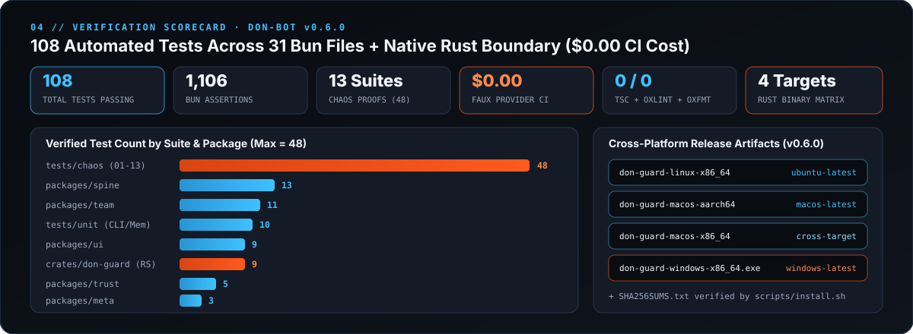
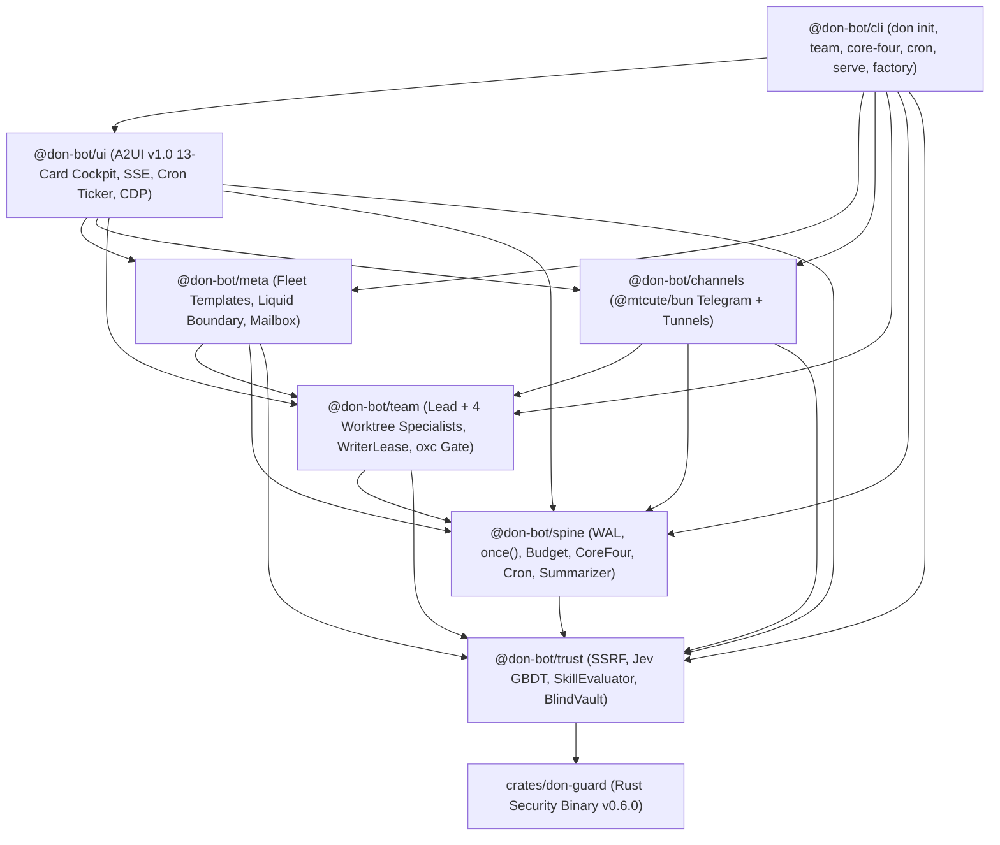
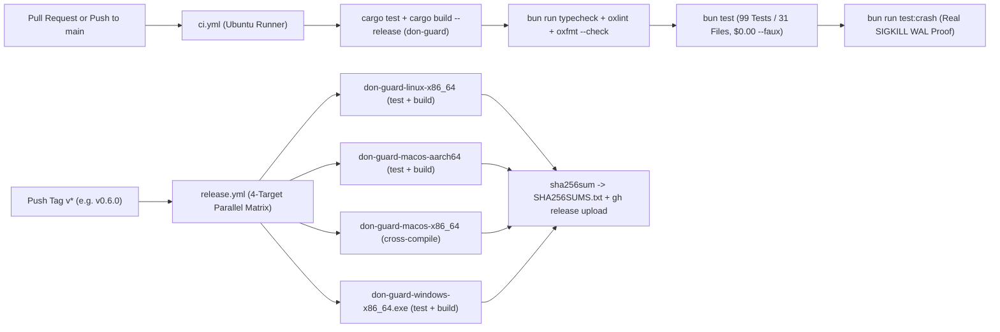
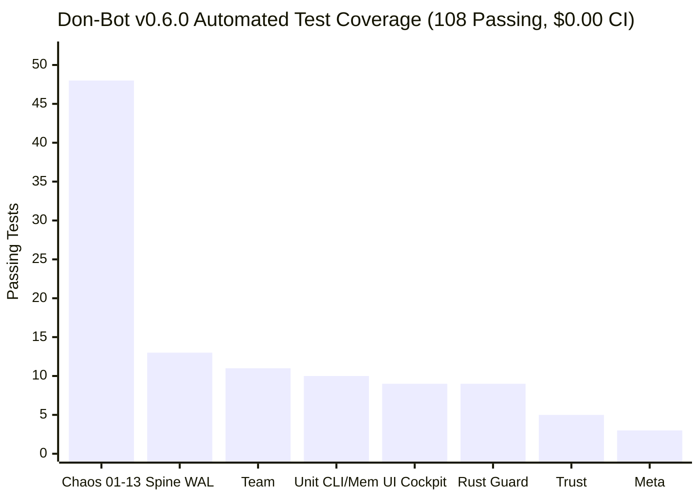

# Contributing to Don-Bot (`v0.6.0`)

Thank you for contributing to Don-Bot (`aegntic/don-bot`). Every change in this repository must preserve SQLite WAL crash durability, fail-closed security gates, non-coding Lead invariants, and zero-error `oxc.rs` / TypeScript hygiene.



---

## 1. Monorepo Package Dependency Map



---

## 2. CI & Cross-Platform Release Pipeline



---

## 3. Verified Automated Test Distribution (`108` Total Tests)



---

## 4. Local Development Setup

**Prerequisites:** [Bun](https://bun.sh) `>= 1.4`, stable Rust (`cargo`, `rustc`), `git`, and optional Linux `bubblewrap` (`bwrap`), `skillevaluator` (`don skills install`), and `safeagents` (`don guard install`).

```bash
git clone https://github.com/aegntic/don-bot.git
cd don-bot

# 1. Build and test the native Rust security boundary first
cargo test --manifest-path crates/don-guard/Cargo.toml
cargo build --release --manifest-path crates/don-guard/Cargo.toml

# 2. Install TypeScript workspace dependencies & run full verification
bun install
bun run check
bun run test:crash
```

---

## 5. Mandatory Pre-PR Verification Gate

Every PR must pass the exact checks enforced by [`.github/workflows/ci.yml`](./.github/workflows/ci.yml):

| Command | Checks |
| :--- | :--- |
| `cargo test --manifest-path crates/don-guard/Cargo.toml` | Rust SSRF, AES-256-GCM + `zeroize` Blind Vault, and Unix/Windows sandbox scrubbing tests (`9` passed) |
| `cargo build --release --manifest-path crates/don-guard/Cargo.toml` | Native release binary used by `don-guard` integration tests |
| `bun run typecheck` | `tsc --noEmit` strict typechecking across `packages/*/src/**/*.ts` and `tests/**/*.ts` |
| `bun run lint` | `oxlint packages tests` with zero errors and zero warnings (`91` files) |
| `bun run fmt:check` | `oxfmt --check packages tests` formatting compliance (`99` files) |
| `bun test` | All co-located module suites, `tests/unit/`, and Chaos Proofs `01–13` (`99` pass across `31` files, `1,106` expects, `$0.00` `--faux`) |
| `bun run test:crash` | Standalone subprocess `SIGKILL` WAL crash-recovery proof |

Run `bun run fmt` before committing to auto-format TypeScript files per [`.oxfmtrc.json`](./.oxfmtrc.json).

---

## 6. Monorepo Architecture Boundaries

When adding or editing modules, preserve invariants documented in [`SPEC.md`](./SPEC.md), [`SECURITY.md`](./SECURITY.md), [`docs/ARCHITECTURE.md`](./docs/ARCHITECTURE.md), and [`docs/WORKFLOWS.md`](./docs/WORKFLOWS.md):

1. **`packages/trust` & `crates/don-guard`:** Never weaken SSRF blocks, secret scrubbing, `<untrusted_tool_result>` escaping, Luhn PAN rejection, or fail-closed defaults. Keep `#[cfg(unix)]` / `#[cfg(windows)]` platform test gates passing on both OS families.
2. **`packages/spine`:** Side effects must use `once()` memos ([`events.ts`](./packages/spine/src/events.ts)), quote provenance ([`memory.ts`](./packages/spine/src/memory.ts)), turn locks ([`turn-lock.ts`](./packages/spine/src/turn-lock.ts)), and non-coding invariant checks in [`core-four.ts`](./packages/spine/src/core-four.ts).
3. **`packages/team`:** Preserve `canWriteCode = false` on Lead & Memory Curator, serialized `WriterLease` merges without auto-push, `.don/` / `node_modules/` exclusions in `commitWorktreeChanges()`, and Verifier cooldown caps (`2` execution failures / `3` verifier loops).
4. **`packages/ui`:** Operator surfaces must strictly validate against 13-component `don.catalog.v1` (`validateA2UISurface`), keep background intervals `.unref()`'d + cleaned up on `stop()`, preserve zero-green palette rules in [`pwa-html.ts`](./packages/ui/src/pwa-html.ts), and keep `/api/*` gated by `.don/access-key`.
5. **`packages/meta`:** Enforce `assertLiquidBoundary` and target-bound single-use `DecisionCard` approvals before mutating fleet state.
6. **Tests First-Class:** Every feature requires deterministic `--faux` tests (`$0.00`) passing offline without live API keys.
