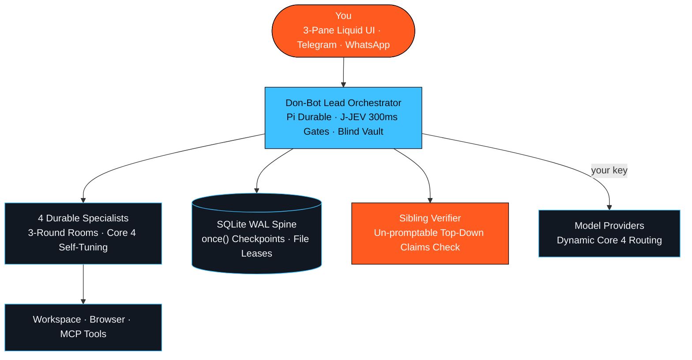

<p align="center">
  <a href="https://don.aegntic.ai">
    
  </a>
</p>

<p align="center">
  <strong>DON-BOT — On-the-Run Dark Factory.</strong><br />
  An autonomous software bot on a crash-proof SQLite WAL spine. One Lead Orchestrator, four durable specialists, 300ms J-JEV gates, Blind Vault, and native Telegram &amp; WhatsApp—running headless while you stay near the loop.
</p>

<p align="center">
  <a href="https://don.aegntic.ai"></a>
  <a href="https://github.com/aegntic/don-bot"></a>
  <a href="https://x.com/aegntic"></a>
</p>

<p align="center">
  <sub>Pi Durable · OTRDF · J-JEV Gates · Blind Vault · Telegram &amp; WhatsApp · 3-Pane Liquid Interface · Free &amp; Open Source</sub>
</p>

<p align="center">
  <a href="https://github.com/aegntic/don-bot"></a>
  <a href="https://don.aegntic.ai"></a>
  <a href="https://don.aegntic.ai"></a>
  <a href="https://don.aegntic.ai"></a>
</p>

<br />

<h2 align="center">00 / ON YOUR MACHINE, NEAR THE LOOP</h2>

<p align="center">
  In the loop, you prompt and babysit.<br />
  Near the loop, a small durable team debates, builds, and verifies before escalating only high-leverage decisions to your inbox.
</p>

<p align="center">
  <a href="https://don.aegntic.ai/#access"></a>
</p>

<p align="center">
  <strong>One lead. Four specialists.</strong><br />
  Durable multi-agent orchestration on a crash-proof SQLite WAL spine—resumes mid-tool after <code>SIGKILL</code> with zero Docker-Postgres bloat.
</p>

<p align="center">
  <a href="https://don.aegntic.ai/#architecture"></a>
</p>

<p align="center">
  <strong>Near the loop, not in it.</strong><br />
  Multi-round architectural room debates, autonomous Core 4 self-tuning, and 300ms J-JEV judgment gates before any high-impact action runs.
</p>

<p align="center">
  <a href="https://don.aegntic.ai/#interface"></a>
</p>

<p align="center">
  <strong>100% agentic access parity.</strong><br />
  Lists on the left. Focus in the center. Durable team on the right. Every button, tab, and canvas pin maps 1:1 to an agent tool—press <code>~</code> anytime to steer.
</p>

<br />

<h2 align="center">01 / CORE ARCHITECTURE</h2>

<p align="center">Built to run for hours on your own hardware without losing state, leaking secrets, or colliding on files.</p>

<table>
  <tr>
    <td width="50%"><strong>Pi Durable &amp; SQLite WAL Spine</strong><br />Crash-proof <code>once()</code> step checkpointing, single-writer file lease locks, and 10%/20%/30% <code>note_to_self</code> memory self-compaction.</td>
    <td width="50%"><strong>Autonomous Core 4 Self-Tuning</strong><br />Each specialist dynamically tunes its own Model, Thinking Effort, Context Window, and Skillset per milestone after a 3-round room debate.</td>
  </tr>
  <tr>
    <td><strong>300ms J-JEV Gates &amp; Sibling Verifier</strong><br />System-One pre-tool judgment gates (~300ms, ~$0.0007) paired with an un-promptable top-down Verifier that checks atomic claims before done.</td>
    <td><strong>Blind Vault &amp; 'Me'-Mode Channels</strong><br />Credentials never enter model context. Operate directly from personal MTProto Telegram &amp; WhatsApp with human-mimicry token-bucket pacing.</td>
  </tr>
</table>

<br />

<h2 align="center">02 / YOUR MACHINE. YOUR MODEL. YOUR RULES.</h2>

- **Runs on your hardware or server.** SQLite WAL state, memory, and workspace files stay local—no mandatory cloud lock-in or heavy Docker-Postgres stack.
- **Model-agnostic Core 4 routing.** Route each specialist to the right model and thinking effort for the slice at hand.
- **Policy lives in the harness, not the prompt.** J-JEV pre-tool gates, single-writer file leases, and the sibling Verifier enforce boundaries outside the agent's prompt context.
- **Secrets stay out of the model.** Blind Vault injects credentials, tokens, and logins privately without exposing them to LLM context windows.
- **100% agentic access parity.** Every control in the 3-Pane Liquid Interface corresponds 1:1 to an agent tool; press `~` (tilde) to inspect or steer any specialist live.

<br />

<h2 align="center">03 / MEASURED, NOT PROMISED</h2>

<p align="center">Engineered around tight latency budgets, zero file collisions, and deterministic recovery.</p>

<table align="center">
  <tr>
    <td align="center" valign="top" width="25%"><h1>1 + 4</h1><strong>durable roster</strong><br /><sub>1 Lead + 4 specialists</sub></td>
    <td align="center" valign="top" width="25%"><h1>~300ms</h1><strong>J-JEV pre-tool gate</strong><br /><sub>~$0.0007 per check</sub></td>
    <td align="center" valign="top" width="25%"><h1>100%</h1><strong>UI-to-tool parity</strong><br /><sub>1:1 agentic access</sub></td>
    <td align="center" valign="top" width="25%"><h1>0</h1><strong>file collisions</strong><br /><sub>single-writer WAL leases</sub></td>
  </tr>
</table>

<br />

<h2 align="center">04 / UNDER THE HOOD</h2>

<p align="center">One durable local spine orchestrating four specialists, verified top-down before anything ships.</p>



- **Crash-proof durability.** Every tool boundary checkpoints through `once()` on SQLite WAL so a `SIGKILL` or reboot resumes cleanly mid-task.
- **Bounded team, not 50-agent chaos.** A persistent 5-agent roster negotiates architecture in 3-round rooms before touching files.
- **Un-promptable verification.** A sibling Verifier inspects atomic claims and diffs independently before marking work complete.

<br />

<h2 align="center">05 / FIVE ARCHITECTURAL SLICES (BUILD IN PUBLIC)</h2>

- **Slice 01 // Spine:** SQLite WAL durable runtime, `once()` checkpointing, single-writer file lease locks, and 10%/20%/30% `note_to_self` self-compaction.
- **Slice 02 // Team:** Lead Orchestrator + 4 durable specialists, 3-round architectural room debates, and autonomous Core 4 self-tuning.
- **Slice 03 // Trust:** 300ms J-JEV System-One judgment gates, Blind Credential Vault, and un-promptable sibling Verifier.
- **Slice 04 // Channels:** Personal `'Me'-Mode` MTProto Telegram &amp; WhatsApp bridge with human-mimicry token-bucket pacing.
- **Slice 05 // UI:** 3-Pane Liquid Interface (Left Lane List, Center Generative UI + live Xvfb screen takeover, Right Decision Deck) with 120fps spring physics.

<br />

<h2 align="center">STRAIGHT ANSWERS</h2>

<details>
<summary><strong>What is an On-the-Run Dark Factory (OTRDF)?</strong></summary>
<br />

An autonomous software factory that keeps building, testing, and verifying while you are away from your keyboard—escalating only high-leverage decisions to your phone via Telegram, WhatsApp, or the 3-Pane Liquid Interface.

</details>

<details>
<summary><strong>Why SQLite WAL instead of Docker + PostgreSQL?</strong></summary>
<br />

Zero container bloat, instant local startup, single-file portability, and crash-proof `once()` step checkpointing with deterministic single-writer file leases.

</details>

<details>
<summary><strong>How do J-JEV gates and Blind Vault keep it safe?</strong></summary>
<br />

Every risky tool call passes through a ~300ms J-JEV System-One judgment gate in the harness before execution, Blind Vault injects credentials outside the LLM's context window, and an un-promptable sibling Verifier audits claims before anything is marked done.

</details>

<details>
<summary><strong>How do I follow the build in public?</strong></summary>
<br />

Subscribe to milestone dispatches at [don.aegntic.ai](https://don.aegntic.ai), star this repository, or follow [@aegntic](https://x.com/aegntic) on X.

</details>

<br />

<h2 align="center">GET DON-BOT</h2>

<p align="center">
  Follow the build in public as each of the five slices lands, or clone the repo to track the architecture from day one.
</p>

<details>
<summary><strong>Clone the repository</strong></summary>
<br />

```sh
git clone https://github.com/aegntic/don-bot.git
cd don-bot
```

See the full build session log in [`docs/session-transcript-9171ff04.jsonl`](docs/session-transcript-9171ff04.jsonl) and the live build dispatch at [don.aegntic.ai](https://don.aegntic.ai).

</details>

<br />

<p align="center">
  <a href="https://don.aegntic.ai">Live Build Dispatch</a> ·
  <a href="https://aegntic.ai">aegntic.ai</a> ·
  <a href="https://x.com/aegntic">@aegntic</a> ·
  <a href="https://github.com/aegntic/don-bot/issues">Issues</a>
</p>

<p align="center">
  <sub>Built in public by <a href="https://aegntic.ai">aegntic.ai</a> · Unlimited Insight. Zero Knowledge.</sub>
</p>
