<p align="center">
  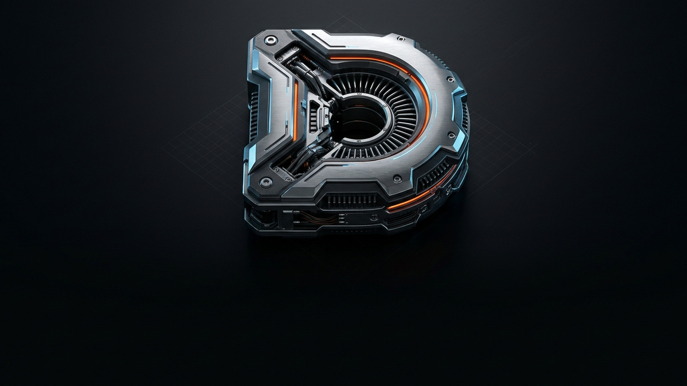
</p>

<h1 align="center">Don-Bot — On-the-Run Dark Factory</h1>

<p align="center">
  <strong>Local-first, crash-durable autonomous software factory on a single SQLite WAL database &amp; Rust security boundary.</strong><br/>
  <em>1 Lead + 4 Worktree Specialists · Native Rust <code>don-guard</code> Sandbox &amp; Blind Vault · 45-Feature System-One Jev · A2UI 1.0 Cockpit · Level 4 Meta-Factory</em>
</p>

<p align="center">
  <a href="https://github.com/aegntic/don-bot/actions/workflows/ci.yml"></a>
  <a href="https://github.com/aegntic/don-bot/releases/tag/v0.6.0"></a>
  
  
  <a href="./LICENSE"></a>
  <a href="https://don.aegntic.ai"></a>
</p>

---

```
┌───────────────────────────────────────────────────────────────────────────────┐
│                       D O N - B O T   ·   v 0 . 6 . 0                       │
├─────────────────┬─────────────────┬─────────────────┬─────────────────────────┤
│   6 WORKSPACES  │   1 RUST CRATE  │    108 TESTS    │   $0.00 FAUX VERIFIED   │
│  spine · trust  │    don-guard    │  99 Bun + 9 RS  │    13 Chaos Proofs +    │
│  team · ui · …  │ AES-GCM · bwrap │  1106 Expects   │    31 Bun Test Files    │
└─────────────────┴─────────────────┴─────────────────┴─────────────────────────┘
```

> **What Don-Bot solves:** Autonomous coding agents fail in four predictable ways — losing state mid-tool crash, leaking host credentials into untrusted tool contexts, burning tokens in unstructured loops, and writing unverified diffs straight onto main. Don-Bot eliminates all four using SQLite WAL `once()` memos, a compiled Rust `don-guard` boundary, 5 System-One Jev gates backed by a 45-feature GBDT ensemble, and isolated per-specialist `git worktree` verification under a serialized `WriterLease`.

<p align="center">
  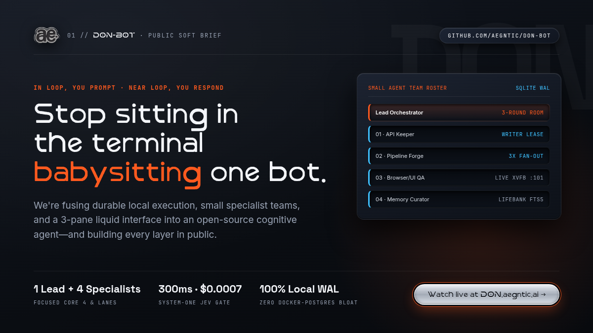
</p>

---

## System Architecture & Visual Flowmaps

<p align="center">
  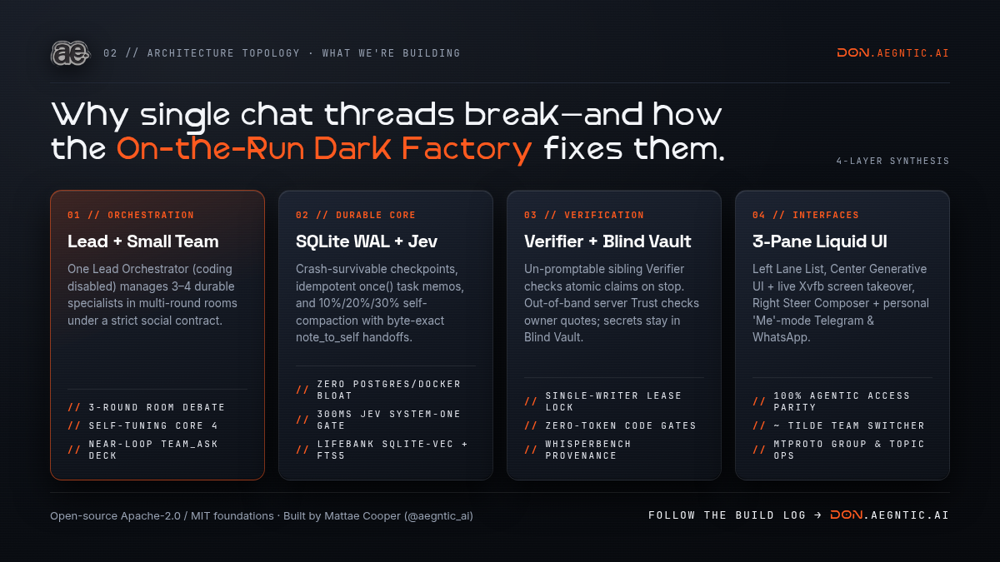
</p>

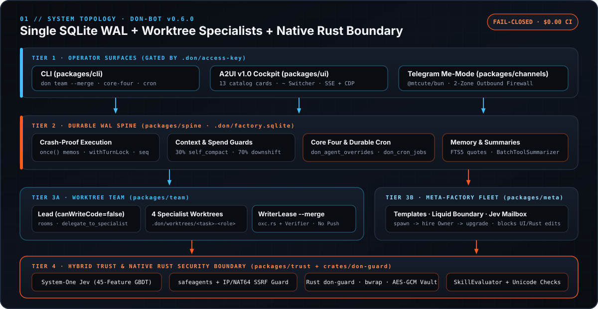

<p align="center">
  <picture>
    <source media="(prefers-color-scheme: dark)" srcset="./assets/diagrams/don-bot-stack-dark.png" />
    <source media="(prefers-color-scheme: light)" srcset="./assets/diagrams/don-bot-stack.png" />
    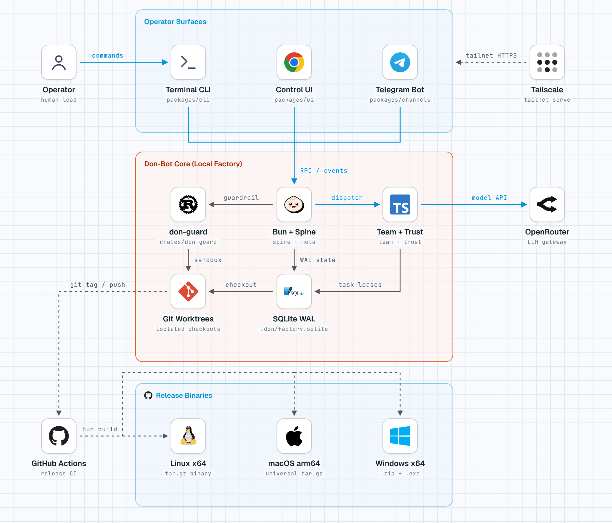
  </picture>
</p>

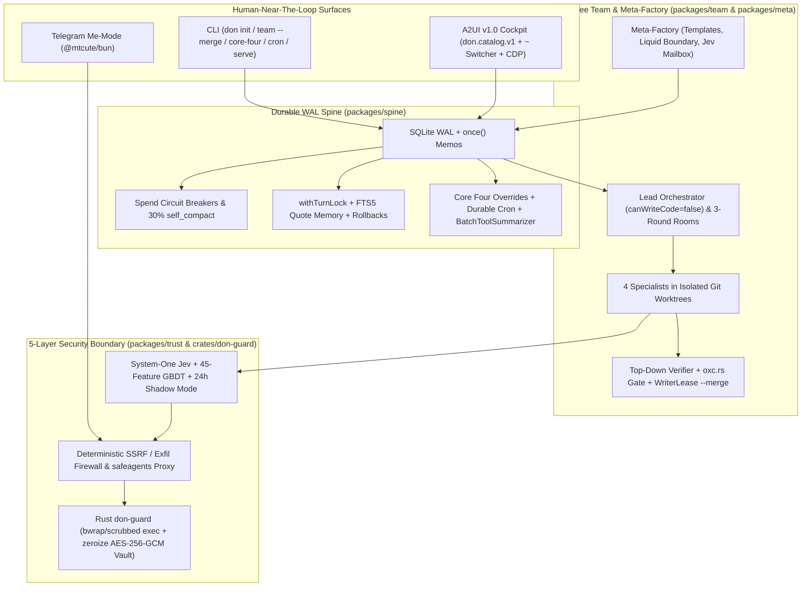

---

## Multi-Agent Worktree Delegation & `--merge` Pipeline

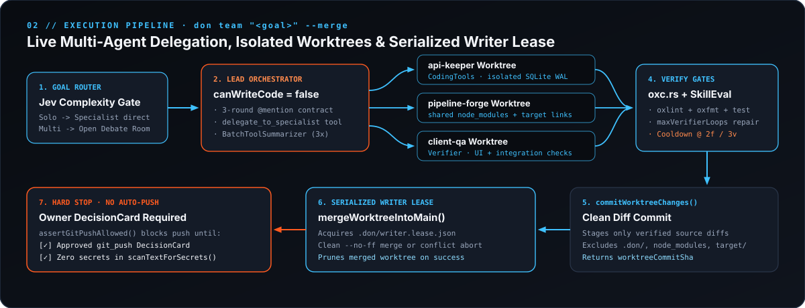

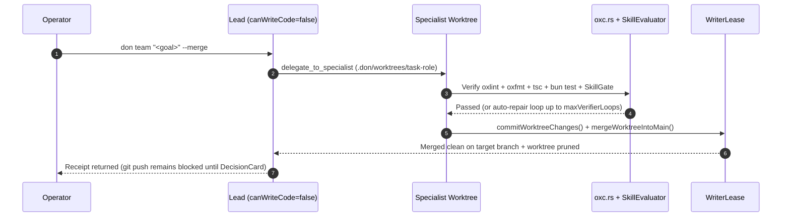

---

## A2UI `v1.0` Cockpit, Core Four Parity & `~` Team Switcher

<p align="center">
  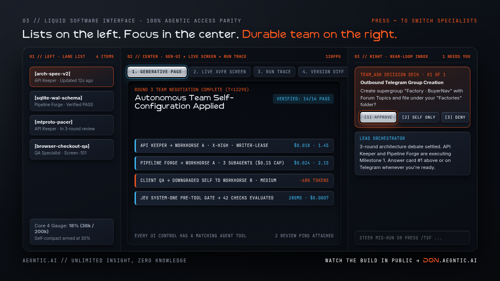
</p>

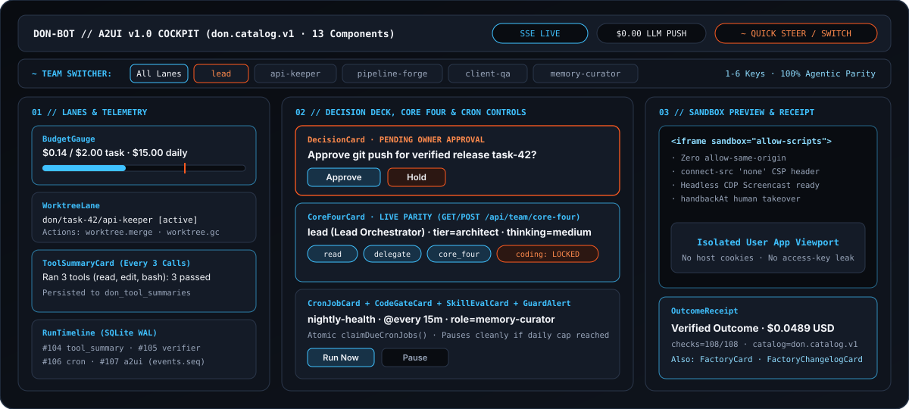

---

## 5-Layer Fail-Closed Security Fortress

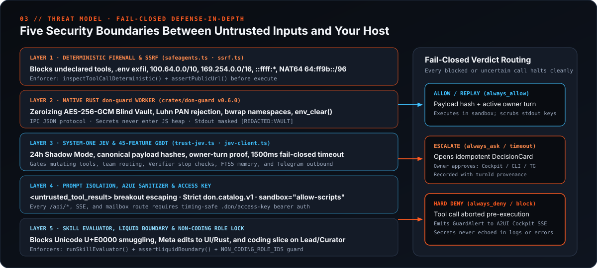

---

## Verification Scorecard & Test Distribution (`108` Passing Tests)

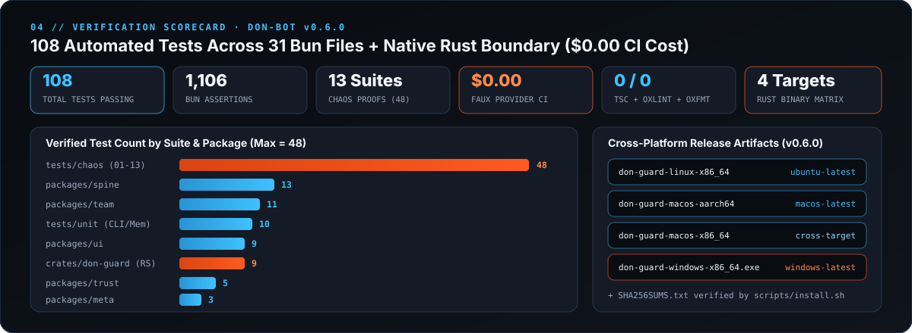

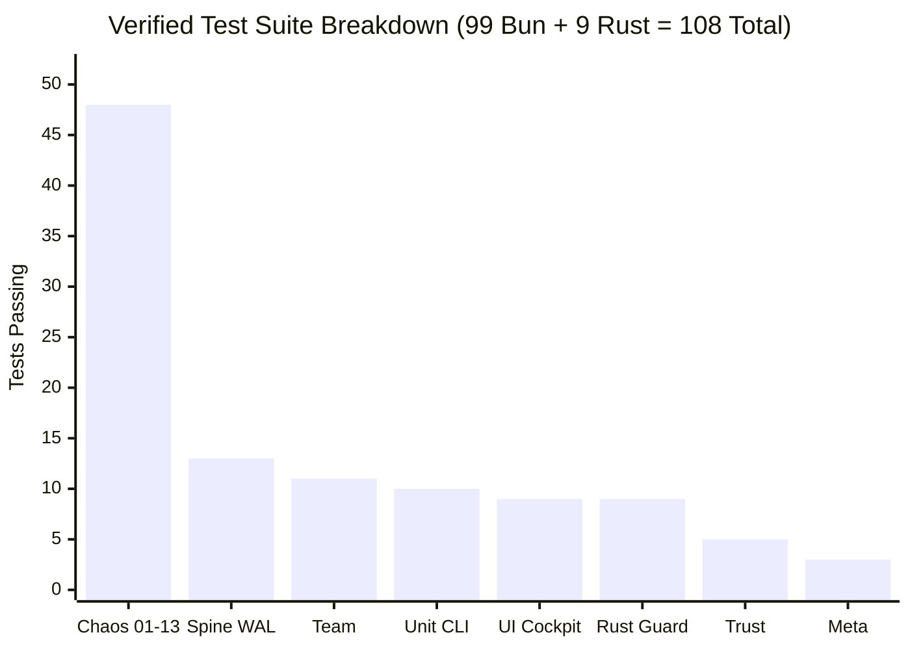

---

## Architecture & Core Source Map

Every subsystem below is strictly typed and covered by deterministic offline `--faux` tests and native Rust `#[cfg(test)]` suites. Explore [`docs/ARCHITECTURE.md`](./docs/ARCHITECTURE.md), [`docs/WORKFLOWS.md`](./docs/WORKFLOWS.md), and [`SECURITY.md`](./SECURITY.md) for deep walkthroughs.

| Layer | Core Modules | Key Primitives & Invariants |
| :--- | :--- | :--- |
| **Rust Security Boundary** | [`crates/don-guard/src/main.rs`](./crates/don-guard/src/main.rs)<br>[`crates/don-guard/src/ssrf.rs`](./crates/don-guard/src/ssrf.rs)<br>[`crates/don-guard/src/vault.rs`](./crates/don-guard/src/vault.rs)<br>[`crates/don-guard/src/sandbox.rs`](./crates/don-guard/src/sandbox.rs) | Native `don-guard` IPC worker: `Zeroizing` AES-256-GCM Blind Vault, Luhn PAN refusal, Tailscale/NAT64/metadata SSRF blocking, `bwrap` / scrubbed `env_clear()` execution, `[REDACTED:VAULT]` masking |
| **Durable WAL Spine** | [`packages/spine/src/runtime.ts`](./packages/spine/src/runtime.ts)<br>[`packages/spine/src/events.ts`](./packages/spine/src/events.ts)<br>[`packages/spine/src/core-four.ts`](./packages/spine/src/core-four.ts)<br>[`packages/spine/src/cron.ts`](./packages/spine/src/cron.ts)<br>[`packages/spine/src/tool-summarizer.ts`](./packages/spine/src/tool-summarizer.ts) | `@earendil-works/pi-durable` + `node:sqlite` WAL, `once()` memos + `InterruptedToolMessage`, `don_agent_overrides` Core Four parity, atomic `claimDueCronJobs()`, and `BatchToolSummarizer` |
| **5-Layer Trust & Jev** | [`packages/trust/src/jev-client.ts`](./packages/trust/src/jev-client.ts)<br>[`packages/trust/src/trust-jev.ts`](./packages/trust/src/trust-jev.ts)<br>[`packages/trust/src/skill-evaluator.ts`](./packages/trust/src/skill-evaluator.ts)<br>[`packages/trust/src/don-guard.ts`](./packages/trust/src/don-guard.ts) | Live Jev + 45-feature GBDT ensemble, 24h Shadow Mode, canonical payload hashes, 6-harness SkillEvaluator (`Unicode` smuggling + PII + static checks), `~/.don/bin` binary resolution |
| **Worktree Team** | [`packages/team/src/orchestrator.ts`](./packages/team/src/orchestrator.ts)<br>[`packages/team/src/verifier.ts`](./packages/team/src/verifier.ts)<br>[`packages/team/src/worktree.ts`](./packages/team/src/worktree.ts) | Lead (`canWriteCode=false`) + 4 Specialists, real `delegate_to_specialist` execution, 3-round `@mention` rooms, serialized `WriterLease` `--merge`, `oxc.rs` code gate, cooldown breakers |
| **Meta-Factory Fleet** | [`packages/meta/src/roles.ts`](./packages/meta/src/roles.ts)<br>[`packages/meta/src/templates.ts`](./packages/meta/src/templates.ts)<br>[`packages/meta/src/mailbox.ts`](./packages/meta/src/mailbox.ts)<br>[`packages/meta/src/workflows.ts`](./packages/meta/src/workflows.ts) | Liquid Boundary immutability, SkillEvaluator-gated backports, target-bound single-use `DecisionCard` enforcement, Jev mailbox, rollback-safe child factory upgrades |
| **A2UI & Channels** | [`packages/ui/src/a2ui.ts`](./packages/ui/src/a2ui.ts)<br>[`packages/ui/src/macros.ts`](./packages/ui/src/macros.ts)<br>[`packages/ui/src/server.ts`](./packages/ui/src/server.ts)<br>[`packages/ui/src/pwa-html.ts`](./packages/ui/src/pwa-html.ts) | Strict 13-component `don.catalog.v1`, `$0.00`-LLM macro hydration, SSE telemetry, background Cron ticker, `~` Team Switcher, headless Chromium CDP, two-zone Telegram firewall |

---

## Verified Engineering Claims & Reproducible Proofs

| Capability | Implementing Code | Proving Chaos / Unit Test | Reproducible Command (`$0.00`) |
| :--- | :--- | :--- | :--- |
| **`SIGKILL` `once()` Replay** | [`packages/spine/src/events.ts`](./packages/spine/src/events.ts) · [`replay.test.ts`](./packages/spine/src/replay.test.ts) | [`01-sigkill-replay.test.ts`](./tests/chaos/01-sigkill-replay.test.ts) | `bun run test:crash` |
| **30% Forced `self_compact`** | [`packages/spine/src/compact.ts`](./packages/spine/src/compact.ts) | [`02-forced-compaction.test.ts`](./tests/chaos/02-forced-compaction.test.ts) | `bun test tests/chaos/02-forced-compaction.test.ts` |
| **SSRF, Prompt Escaping & Sandbox** | [`packages/trust/src/ssrf.ts`](./packages/trust/src/ssrf.ts) · [`ssrf.test.ts`](./packages/trust/src/ssrf.test.ts) | [`03-prompt-injection-safeagents.test.ts`](./tests/chaos/03-prompt-injection-safeagents.test.ts) | `bun test tests/chaos/03-prompt-injection-safeagents.test.ts` |
| **Worktrees, `WriterLease` & `oxc.rs`** | [`packages/team/src/worktree.ts`](./packages/team/src/worktree.ts) · [`code-gate.ts`](./packages/team/src/code-gate.ts) | [`04-worktree-merge-lease.test.ts`](./tests/chaos/04-worktree-merge-lease.test.ts) | `bun test tests/chaos/04-worktree-merge-lease.test.ts` |
| **Spend Downshift & Breakers** | [`packages/spine/src/budget.ts`](./packages/spine/src/budget.ts) · [`budget.test.ts`](./packages/spine/src/budget.test.ts) | [`05-budget-circuit-breaker.test.ts`](./tests/chaos/05-budget-circuit-breaker.test.ts) | `bun test tests/chaos/05-budget-circuit-breaker.test.ts` |
| **6-Harness SkillEvaluator Gate** | [`packages/trust/src/skill-evaluator.ts`](./packages/trust/src/skill-evaluator.ts) | [`06-skill-evaluator-gate.test.ts`](./tests/chaos/06-skill-evaluator-gate.test.ts) | `bun test tests/chaos/06-skill-evaluator-gate.test.ts` |
| **Debate Rooms & Top-Down Verifier** | [`packages/team/src/verifier.ts`](./packages/team/src/verifier.ts) · [`verifier.test.ts`](./packages/team/src/verifier.test.ts) | [`07-slice02-verifier-replay.test.ts`](./tests/chaos/07-slice02-verifier-replay.test.ts) | `bun test tests/chaos/07-slice02-verifier-replay.test.ts` |
| **Rust `don-guard` & Blind Vault** | [`crates/don-guard/src/main.rs`](./crates/don-guard/src/main.rs) · [`don-guard.ts`](./packages/trust/src/don-guard.ts) | [`08-slice03-don-guard-jev-vault.test.ts`](./tests/chaos/08-slice03-don-guard-jev-vault.test.ts) | `cargo test --manifest-path crates/don-guard/Cargo.toml` |
| **Telegram "Me" Mode Firewall** | [`packages/channels/src/firewall.ts`](./packages/channels/src/firewall.ts) | [`09-slice04-telegram-firewall.test.ts`](./tests/chaos/09-slice04-telegram-firewall.test.ts) | `bun test tests/chaos/09-slice04-telegram-firewall.test.ts` |
| **A2UI `v1.0` Cockpit & `~` Switcher** | [`packages/ui/src/a2ui.ts`](./packages/ui/src/a2ui.ts) · [`cockpit-parity.test.ts`](./packages/ui/src/cockpit-parity.test.ts) | [`10-slice05-a2ui-cockpit.test.ts`](./tests/chaos/10-slice05-a2ui-cockpit.test.ts) | `bun test tests/chaos/10-slice05-a2ui-cockpit.test.ts` |
| **45-Feature GBDT System-One Jev** | [`packages/trust/src/jev-client.ts`](./packages/trust/src/jev-client.ts) · [`jev-client.test.ts`](./packages/trust/src/jev-client.test.ts) | [`11-jev-system-one-agents.test.ts`](./tests/chaos/11-jev-system-one-agents.test.ts) | `bun test tests/chaos/11-jev-system-one-agents.test.ts` |
| **OAuth Vault & Cockpit Pairing** | [`packages/spine/src/credentials.ts`](./packages/spine/src/credentials.ts) · [`onboard.ts`](./packages/cli/src/onboard.ts) | [`12-onboarding-oauth-vault.test.ts`](./tests/chaos/12-onboarding-oauth-vault.test.ts) | `bun test tests/chaos/12-onboarding-oauth-vault.test.ts` |
| **Meta-Factory Fleet & Mailbox** | [`packages/meta/src/roles.ts`](./packages/meta/src/roles.ts) · [`mailbox.test.ts`](./packages/meta/src/mailbox.test.ts) | [`13-slice06-meta-factory.test.ts`](./tests/chaos/13-slice06-meta-factory.test.ts) | `bun test tests/chaos/13-slice06-meta-factory.test.ts` |

---

## 60-Second Quickstart (Linux / macOS / Windows)

**Requirements:**
- [Bun](https://bun.sh) `>= 1.4`
- Rust toolchain (`cargo`, `rustc` stable) if building [`crates/don-guard`](./crates/don-guard/Cargo.toml) from source (or use the prebuilt installer below)
- `git`, optional Linux `bubblewrap` (`bwrap`), and optional `safeagents` (`don guard install`)

```bash
git clone https://github.com/aegntic/don-bot.git don-bot
cd don-bot

# Option A: Install prebuilt cross-platform don-guard binary (Linux x64 / macOS arm64 & x64) into ~/.don/bin
curl -fsSL https://raw.githubusercontent.com/aegntic/don-bot/main/scripts/install.sh | sh

# Option B: Build & verify the native Rust security boundary from source
cargo test --manifest-path crates/don-guard/Cargo.toml
cargo build --release --manifest-path crates/don-guard/Cargo.toml

# Install dependencies & run the full CI gate (typecheck + oxlint + oxfmt + 99 Bun tests + SIGKILL crash proof)
bun install
bun run check
bun run test:crash
```

`bun run test:crash` spends **$0.00**: it launches [`tests/chaos/fixtures/sigkill-worker.ts`](./tests/chaos/fixtures/sigkill-worker.ts) in `--faux` mode, sends `SIGKILL` mid-execution, restarts against the same SQLite WAL database, proves completed `once()` steps ran **exactly once**, and injects `InterruptedToolMessage` for unsafe interrupted steps.

---

## Zero-Friction OAuth & Key Onboarding

Run the guided wizard once per workspace — **one OpenRouter OAuth login** (`don login openrouter`) automatically activates all 4 LLM tiers **and** live System-One Jev (`typesafe/jev-1.14`), sealing all secrets encrypted inside SQLite (`don_provider_credentials` via `don-guard` / `AES-256-GCM`):

```bash
bun run don onboard --dir /path/to/your-repo      # Guided interactive setup (OAuth / masked keys / Telegram Blind Vault)
bun run don login openrouter                      # Direct 1-click OAuth PKCE (or: anthropic, openai, openai-codex, github-copilot)
bun run don serve --dir /path/to/your-repo        # Prints a 5-min single-use pairing code (DON-XXXXXX) for the browser Cockpit
```

Or use any ambient environment key (`ANTHROPIC_API_KEY`, `OPENAI_API_KEY`, `GEMINI_API_KEY`, `OPENROUTER_API_KEY`, `TYPESAFE_API_KEY`) and run:

```bash
bun run don init --dir /path/to/your-repo
bun run don status --dir /path/to/your-repo
bun run don team "Add healthcheck endpoint and unit test" --dir /path/to/your-repo --faux --merge
```

---

## `don` CLI Reference

| Command | Purpose |
| :--- | :--- |
| `don init [--dir <path>]` | Create `.don/factory.sqlite` (WAL), `.don/config.yaml`, `.don/access-key`, and `.don/.gitignore` |
| `don onboard [--dir <path>] [--non-interactive]` | Guided setup for OAuth AI brain (`openrouter`/`claude`/`chatgpt`/`copilot`), System-One Jev & Telegram Blind Vault |
| `don login [provider] [--dir <path>]` | Run built-in OAuth PKCE / Device Code sign-in (`openrouter` default unlocks AI + Jev) |
| `don auth <status\|set\|logout>` | Inspect, encrypt into SQLite (`--key-stdin` supported), or remove provider credentials without echoing secrets |
| `don run "<goal>" [--faux] [--role <id>] [--worktree] [--verify] [--merge]` | Run a single-lane task directly without opening a debate room |
| `don team "<goal>" [--faux] [--role <id>] [--worktree] [--verify] [--merge]` | Run Lead + delegated Specialist worktree orchestration, verify code gate, and merge cleanly via Writer Lease |
| `don cron <list\|add\|pause\|resume\|delete\|run-now>` | Create, toggle, inspect, and execute durable SQLite-backed scheduled prompts (with daily budget cap guards) |
| `don core-four <list\|set\|slice\|reset>` | Tune per-role Model/Tier, Thinking, Harness Slices, and Extra Instructions while keeping non-coding Lead invariants |
| `don status [--dir <path>]` | Report SQLite WAL status, `safeagents` guard mode, budget caps, queue counts, and active worktrees |
| `don serve [--port <n>] [--host <addr>]` | Start the authenticated A2UI `v1.0` / SSE 3-pane Liquid PWA Cockpit (`127.0.0.1:4321`) + Cron ticker + `DON-XXXXXX` pairing |
| `don resume [--dir <path>]` | Inspect paused/interrupted tasks, incomplete `once()` memos, blocked cooldowns, and Decision Deck cards |
| `don guard <status\|rust-status\|jev-status\|block\|log-only\|install>` | Check `safeagents`, compiled Rust `don-guard`, or Jev System-One config & toggle guard mode |
| `don vault <set\|list>` | Store or list host-bound AES-256-GCM Blind Vault credentials (never echoes secret plaintext) |
| `don rollback <create\|list>` | Create or list HMAC-SHA256 signed git worktree + SQLite rollback checkpoints |
| `don channel status` | Inspect `@mtcute/bun` Telegram "Me" Mode driver, `EXCLUSIONS.txt`, and tunnel tools |
| `don tunnel <tailscale\|cloudflared>` | Print zero-port remote access command (`tailscale serve` / `cloudflared`) and detect binaries |
| `don skills <status\|eval\|harness\|history\|block\|log-only\|install>` | Run core NVIDIA SkillEvaluator checks, 6-harness checks, history, and gate mode |
| `don template <list\|clone>` | List or clone versioned Blank Factory Templates (`don-core-v1`) |
| `don factory <list\|spawn\|hire\|upgrade\|audit\|changelog\|archive\|mailbox>` | Manage Meta-Factory child workspaces, 1:1 owners, upgrades, and Jev-gated mailbox |
| `don worktree gc [--dir <path>]` | Prune merged or orphaned `.don/worktrees/*` checkouts and clean `don/*` branches |
| `don test:crash` | Run Chaos Test 1 (`SIGKILL` + `once()` recovery) |

---

## 6-Slice Architecture Roadmap

| Slice | Scope | Status |
| :--- | :--- | :--- |
| **Slice 01** | Durable WAL Spine, 4-Layer Trust, 1 Lead + 4 Specialists, Worktrees, `oxc` Gate, `don` CLI | **Complete (`v0.1.0-slice-01` · `main`)** |
| **Slice 02** | 3-round debate rooms, Top-Down Verifier loop, subagent privilege stripping & time-travel fork | **Complete (`main`)** |
| **Slice 03** | Rust `crates/don-guard` native OS sandbox + `trust-jev` owner-quote calibration & Blind Vault | **Complete (`main`)** |
| **Slice 04** | Telegram MTProto (`@mtcute/bun@0.32.8`, zero C++ builds) operator channel (`packages/channels`) | **Complete (`main`)** |
| **Slice 05** | **A2UI 1.0** Custom Catalog (`don.catalog.v1`) + TypeScript Macro Hydration + 3-Pane PWA Cockpit (`packages/ui`) | **Complete (`main`)** |
| **Slice 06** | **Meta-Factory Fleet (`packages/meta`)** + Core Four Parity + Durable Cron + Multi-Agent `--merge` + Cross-Platform Release | **Complete (`v0.6.0` · `main`)** |

<details>
<summary>Don-Bot Architecture Visual Overview</summary>

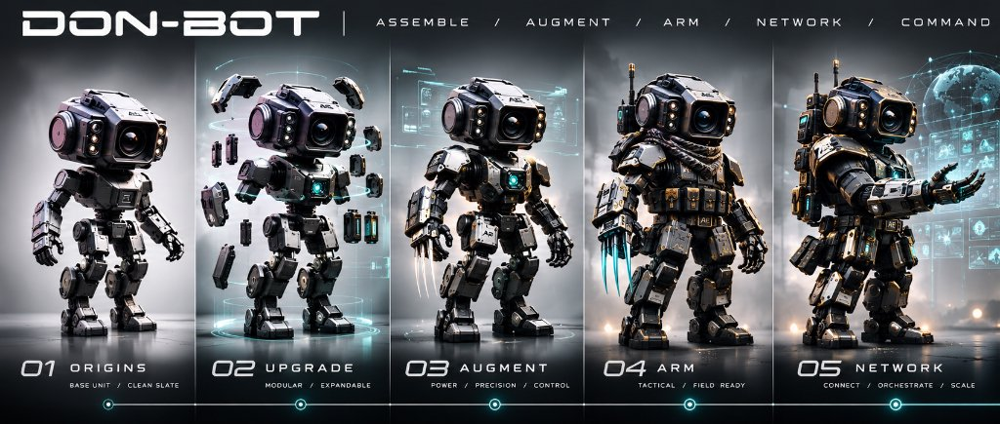

</details>

---

## Documentation, Governance & Attribution

- Deep Architecture Reference: [`docs/ARCHITECTURE.md`](./docs/ARCHITECTURE.md)
- Visual Operational Playbook & Flowmaps: [`docs/WORKFLOWS.md`](./docs/WORKFLOWS.md)
- Specification & Invariants: [`SPEC.md`](./SPEC.md)
- Security Policy & Threat Model: [`SECURITY.md`](./SECURITY.md)
- Contributor Guide & Verification Gate: [`CONTRIBUTING.md`](./CONTRIBUTING.md)
- Configuration Template: [`don.config.example.yaml`](./don.config.example.yaml)
- CI & Release Workflows: [`.github/workflows/ci.yml`](./.github/workflows/ci.yml) · [`.github/workflows/release.yml`](./.github/workflows/release.yml)
- Apache-2.0 License & Port Attribution: [`LICENSE`](./LICENSE) · [`NOTICE`](./NOTICE)
- Legacy `n8n-io/nod` Fork Reference: Archived intact on git branch `legacy/nod-reference`
