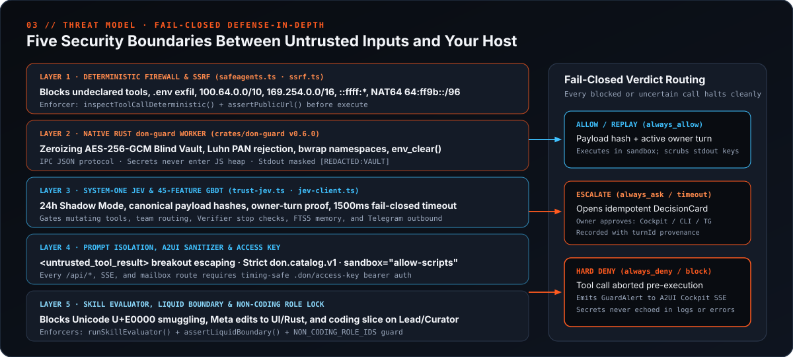
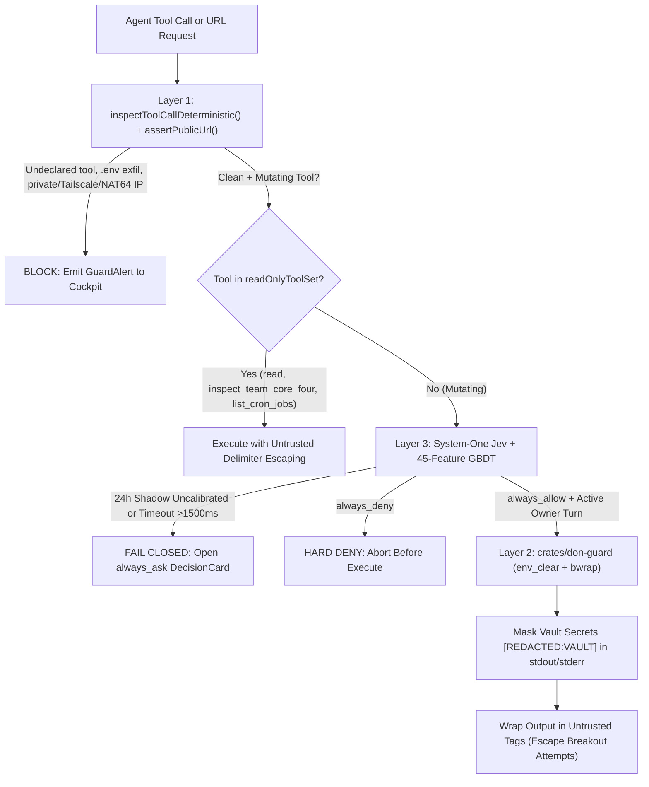
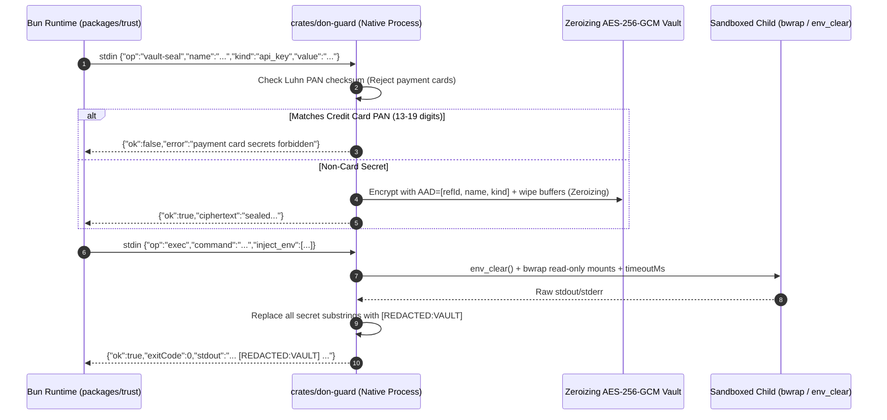
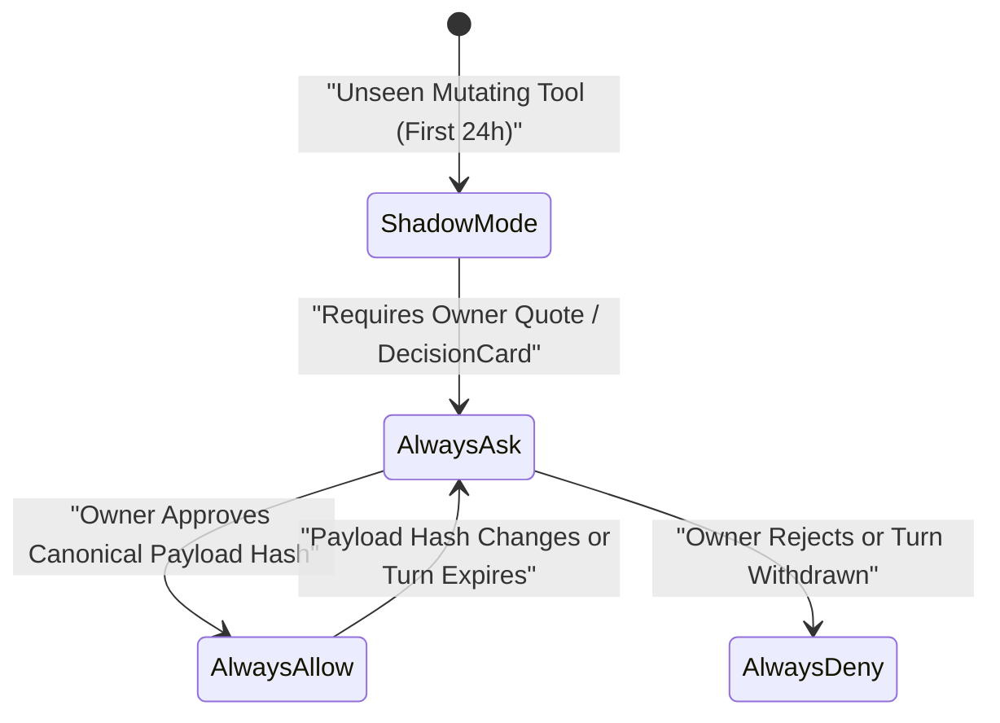
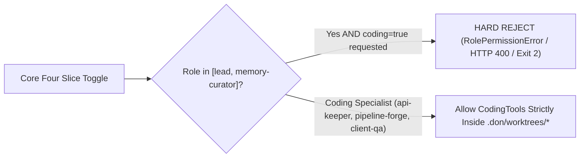

# Security Policy & Threat Model (`v0.6.0`)

Don-Bot is engineered around a **fail-closed, local-first security boundary**. No autonomous agent, downloaded skill, or external chat payload is trusted with unguarded host execution, raw credentials, or unapproved external mutations.

---

## 1. End-to-End Tool Execution & SSRF Inspection Flow

---

## 2. Rust `don-guard` JSON IPC & Blind Vault Flow

---

## 3. Role Privilege & Tool Approval State Machine

---

## 4. Defense-in-Depth Layers

| Layer | Enforcer | Source | Guarantee |
| :--- | :--- | :--- | :--- |
| **1 · Deterministic Tool Firewall & SSRF** | `inspectToolCallDeterministic`, `assertPublicUrl` | [`packages/trust/src/safeagents.ts`](./packages/trust/src/safeagents.ts) · [`packages/trust/src/ssrf.ts`](./packages/trust/src/ssrf.ts) | Blocks undeclared tools, `.env`/secret exfiltration paths, RFC1918 networks, Tailscale CGNAT (`100.64.0.0/10`), cloud metadata (`169.254.0.0/16`), link-local IPv6, IPv4-mapped IPv6 (`::ffff:*`), and NAT64 (`64:ff9b::/96`). |
| **2 · Native Rust Security Boundary (`v0.6.0`)** | `don-guard` CLI worker (`stdin`/`stdout` JSON IPC) | [`crates/don-guard/src/main.rs`](./crates/don-guard/src/main.rs) · [`crates/don-guard/src/vault.rs`](./crates/don-guard/src/vault.rs) | Isolates AES-256-GCM Blind Vault cryptography (`zeroize` memory wiping), payment-card Luhn PAN rejection, host-bound `x-mcp-header` secret injection, env-scrubbed execution, and `[REDACTED:VAULT]` masking outside the Bun/JS heap. |
| **3 · Calibrated System-One Jev + Shadow Mode** | `evaluateTrustGate`, 45-feature GBDT ensemble | [`packages/trust/src/trust-jev.ts`](./packages/trust/src/trust-jev.ts) · [`packages/trust/src/jev-client.ts`](./packages/trust/src/jev-client.ts) | Enforces 24-hour Shadow Mode calibration on unseen mutating tools, SHA-256 canonical JSON payload hashes for `always_allow`, live owner-turn verification, and `1500 ms` fail-closed timeouts. |
| **4 · Prompt Isolation, A2UI & Operator Auth** | `<untrusted_tool_result>` escaping, `.don/access-key`, `withTurnLock` | [`packages/trust/src/untrusted.ts`](./packages/trust/src/untrusted.ts) · [`packages/trust/src/access-key.ts`](./packages/trust/src/access-key.ts) | Neutralizes closing-tag breakout injection; gates `/api/*`, SSE, WS, and cross-factory mailbox calls behind timing-safe `.don/access-key` auth; isolates user previews in `<iframe sandbox="allow-scripts">` with zero-network CSP. |
| **5 · Skill Supply-Chain, Liquid Boundary & Role Lock** | `runSkillEvaluator`, `assertLiquidBoundary`, `NON_CODING_ROLE_IDS` | [`packages/trust/src/skill-evaluator.ts`](./packages/trust/src/skill-evaluator.ts) · [`packages/meta/src/roles.ts`](./packages/meta/src/roles.ts) | Scans skills for PII/secrets/Unicode smuggling (`U+E0000`) and 6-harness checks; blocks meta-level edits to `packages/ui`, `crates/don-guard`, `vault.ts`, `ssrf.ts`; forbids `coding` slice on `lead` & `memory-curator`. |

---

## 5. OS Sandboxing & Verified Binary Distribution

- **Linux:** Wraps commands in `bubblewrap` (`bwrap --die-with-parent --new-session --proc /proc --dev /dev --tmpfs /tmp`) with read-only system mounts when user namespaces are permitted, falling back transparently to `linux-scrubbed-subprocess` when restricted. Both modes wipe `*_API_KEY`, `*_SECRET`, `*_TOKEN`, `*_PASSWORD`, `*_PRIVATE_KEY`, and explicit tokens via `.env_clear()`.
- **macOS & Windows:** Combines git-worktree isolation with scrubbed subprocess environments (`#[cfg(windows)]` verified on Windows Server runners) and hard process timeouts.
- **Supply-Chain Checksums:** [`scripts/install.sh`](./scripts/install.sh) verifies prebuilt release binaries (`don-guard-linux-x86_64`, `don-guard-macos-aarch64`, `don-guard-macos-x86_64`) against release-signed `SHA256SUMS.txt` fail-closed before running a `health` probe into `~/.don/bin/don-guard`.

---

## 6. Reporting a Vulnerability

If you discover a security bypass in SSRF validation, `don-guard`, Blind Vault AAD binding, A2UI payload validation, Core Four invariants, or Meta-Factory authorization:

1. **Do not** open a public issue with exploit payloads against live deployments.
2. Open a private security advisory on GitHub at [github.com/aegntic/don-bot/security/advisories](https://github.com/aegntic/don-bot/security/advisories) with the affected file/commit SHA, minimal failing reproduction, and expected fail-closed invariant.
3. Every security fix is shipped with regression proofs in `tests/chaos/` and co-located `*.test.ts` / Rust `#[cfg(test)]` suites.
