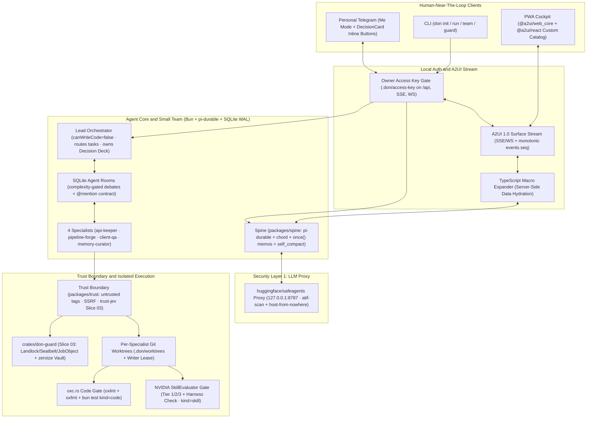

# Don-Bot Specification (`SPEC.md`)

**Project:** Don-Bot — On-the-Run Dark Factory (`github.com/aegntic/don-bot`)  
**Standard:** ASD-STE100 Simplified Technical English  
**Target OS Support:** Linux, macOS, Windows  
**Slice 01 Target Date:** December 1, 2026 (`v0.1.0-slice-01`)

---

## 1. System Goal and Design Principles

Don-Bot is a single-box, local-first software factory. You assign an engineering goal, answer high-impact cards in the **Decision Deck**, and review verified code on your branch.

1. **Zero Heavy Infrastructure:**
   - Don-Bot runs from one SQLite WAL database (`node:sqlite` in Bun) and local `git worktree` checkouts.
   - Don-Bot requires no Docker daemon, no PostgreSQL server, no cloud VM, and no C++ build toolchain on install.
2. **Hybrid Performance and Security Stack:**
   - **Agent Core (`Bun 1.4+` + `TypeScript` + `oxc.rs`):** `@earendil-works/pi-durable@1.6.0`, `@earendil-works/chord@1.6.0`, and `@earendil-works/pi-codemode@1.6.0` run the durable **Spine**, CLI, and UI server.
   - **Code Gate (`oxc.rs`):** `oxlint` and `oxfmt` run sub-100 ms `kind="code"` lint and format checks after specialist edits.
   - **Skill Gate (`NVIDIA/SkillEvaluator`):** Core Tier 1 static, security, PII, Unicode smuggling, and 6-harness compatibility checks run on Agent Skills (`kind="skill"`), using the `skillevaluator` CLI when installed or the built-in zero-dependency fallback.
   - **Security Boundary (`crates/don-guard` in Rust, Slice 03):** A standalone Rust binary isolates OS sandboxing, `zeroize` AES-256-GCM secrets, `x-mcp-header` injection, and the IP-class SSRF firewall from JavaScript process memory.
   - **Desktop and Mobile Delivery (`packages/ui`):** Don-Bot ships a local daemon and installable PWA using **A2UI 1.0** (`@a2ui/web_core` + `@a2ui/react`) for Linux, macOS, Windows, iOS, and Android. An optional Rust **Tauri** wrapper follows after Slice 05.
3. **Greenfield Monorepo and Selective Porting:**
   - Branch `legacy/nod-reference` preserves the original `n8n-io/nod` fork commit history.
   - Branch `main` runs a clean monorepo with `packages/trust`, `packages/spine`, `packages/team`, `packages/cli`, `packages/channels`, `packages/ui`, and Slice 03 `crates/don-guard`.
   - `NOTICE` retains Apache-2.0 attribution for ported security modules:
     - `src/server/trust-jev*.ts`, `trust-jev-model.json`, `trust-basis.ts`, and `trust-facts.ts` (replacing the unavailable `@dna/jev` npm package)
     - `src/runtime/untrusted.ts` and `src/shared/untrusted.ts`
     - `src/server/vault-crypto.ts` and `src/server/vault-use.ts` (secret encryption and redaction only)
     - `src/shared/public-address.ts` and `src/shared/loopback.ts`
     - `src/server/turn-cancellation.ts` (turn lock, `AbortSignal`, and turn withdrawal logic)

---

## 2. Macro Architecture

---

## 3. Five-Slice Roadmap Matrix

| Slice | Package Focus | Core Capabilities |
| :--- | :--- | :--- |
| **Slice 01 // Spine + Basic Team** *(Delivered baseline: `v0.1.0-slice-01`)* | `trust`, `spine`, `team`, `cli` | • Greenfield Bun + `oxc.rs` monorepo on `node:sqlite` WAL (`packages/trust`, `packages/spine`, `packages/team`, `packages/cli`, plus `channels` and `ui` stubs). • Durable **Spine**: `@earendil-works/pi-durable@1.6.0` + `chord@1.6.0`, monotonic `events.seq`, `once()` side-effect memos, `InterruptedToolMessage`, `withTurnLock`, and turn withdrawal. • Context & Spend Guards: `10%` / `20%` / `30%` `self_compact({ note_to_self })`, `70%` fast-tier downshift, and `$0.25` / `$2.00` / `$15.00` circuit breakers. • **Trust Boundary** (core): `safeagents` managed sidecar (`127.0.0.1:8787`), `<untrusted_tool_result>` tag escaping, IP-class SSRF guard, scrubbed child environment / `bwrap` `SandboxPort`, `.don/access-key`, and core **NVIDIA SkillEvaluator** (`kind="skill"`) gate + `don_skill_evals` WAL ledger. • Small Team: `1 Lead + 4 Specialists` roster (`canWriteCode=false` on Lead), SQLite `@mention` rooms, `2`-failure / `3`-verifier cooldown, `.don/worktrees/<task>-<role>`, atomic **Writer Lease**, and `oxc.rs` **Code Gate**. • 4-tier 1-key BYOK `.don/config.yaml`, FTS5/BM25 quote-anchored memory, `don` CLI (`don skills`), and all 6 zero-cost `--faux` CI Chaos Tests. |
| **Slice 02 // Full Team & Verification** | `team`, `spine` | • Full 3-round cross-lane architectural debate rooms (active only when complexity classification requires multi-lane consensus). • Un-promptable Top-Down sibling Verifier (`max_loops: 3`) that inspects session traces before stop approval. • Automated live repo specialist edit loop inside isolated **Worktrees** using `Code Gate` and `Skill Gate` (Tier 1/2/3 `skillevaluator`) feedback until green. • Subagent privilege stripping (remove git push keys and channel tokens; enforce depth, instance count, and idle timeouts). • Time-travel replay and branch fork from any saved step `N` without repeating completed `once()` side effects. |
| **Slice 03 // Trust, Blind Vault & Rust `don-guard`** | `trust`, `crates/don-guard` | • Ported fail-closed `trust-jev.ts` owner-quote check (`~300 ms`). • Per-tool permission schema (`always_allow`, `always_ask`, `always_deny`) bound to canonical JSON argument payloads. • Standalone Rust binary `crates/don-guard` behind `SandboxPort` and `VaultPort`: &nbsp;&nbsp;- Native OS sandboxes: Linux `Landlock` + `seccomp-BPF`, macOS `Seatbelt`, and Windows `Job Objects`. &nbsp;&nbsp;- `zeroize` AES-256-GCM Blind Vault (API keys, OAuth tokens, Git SSH keys, staging logins — never payment cards), `x-mcp-header` outbound injection, and stdout/screenshot secret masking. &nbsp;&nbsp;- Standalone SSRF firewall blocking loopback, Tailscale CGNAT (`100.64.0.0/10`), RFC1918, NAT64, and cloud metadata (`169.254.0.0/16`). • One-tap signed rollback checkpoints (git worktree ref + SQLite savepoint) and 24-hour Shadow Mode calibration for new tools. |
| **Slice 04 // Telegram "Me" Mode & Remote Access** | `channels`, `spine` | • `@mtcute/node@0.32.8` + `@mtcute/sqlite` behind `ChannelPort`: QR login, auto-created supergroup Forum Topics, and auto-filed `"Factories"` folder. • Two-zone outbound firewall: internal factory rooms post updates freely; external chats require an owner quote or `👍` draft approval in Saved Messages. • Anti-flag protections: single pinned desktop session, human read/typing delays, invite links only (no forced `inviteToChannel`), and `EXCLUSIONS.txt` denylist. • Voice notes -> STT -> Lead batch-resolving **Decision Deck** cards. • Shared `DecisionCard` schema projected to compact Telegram inline buttons so approvals match the web cockpit. • Zero-port remote access via Tailscale Serve or `cloudflared` tunnel + `.don/access-key` + resumable `events.seq` SSE cursor *(Optional Slice 04b: WhatsApp Baileys behind `ChannelPort`)*. |
| **Slice 05 // A2UI 1.0 + 3-Pane Liquid PWA Cockpit** | `ui`, `spine` | • Local HTTP/SSE/WS server + installable PWA running on Linux, macOS, Windows, iOS, and Android. • **A2UI 1.0 (`@a2ui/web_core` + `@a2ui/react`)** bound to Don-Bot's **Custom Catalog** (`don.catalog.v1`) and styled by a spring-liquid cockpit system (`motion/react`, CSS View Transitions, `@starting-style`, `@number-flow/react`, and curated cockpit card shells). • **TypeScript Macro Expander** inside `packages/spine` and `packages/ui`: expands compact model macro calls into full A2UI JSON and hydrates sensitive telemetry server-side. • Zero-LLM push updates from SQLite/Spine events directly to connected clients at `$0.00` token cost. • Authenticated `/api/a2ui/action` handler that writes owner-approved actions into `don_turns` and resolves `don_decision_deck` under `withTurnLock`. • On-demand headless Chromium CDP `Page.startScreencast` with `handback_at` human takeover (active only during browser tasks). • Untrusted user-project previews isolated inside `<iframe sandbox="allow-scripts">` (no `allow-same-origin`, no-network CSP) + cost-per-outcome receipts *(Post-Slice 05: optional Tauri wrapper, SwiftUI/Kotlin A2UI native companions, `sqlite-vec`, browser voice)*. |

---

## 4. A2UI 1.0 Protocol, Custom Catalog, and TypeScript Macro Hydration

### 4.1 Core Separation Rule

Don-Bot separates **content selection** from **UI rendering**.

1. An AI agent **MUST** emit only declarative **A2UI 1.0** **Surface** descriptions and registered catalog component IDs.
2. An AI agent **MUST NOT** emit raw HTML, CSS, JavaScript, or iframe tags for Don-Bot operator controls.
3. The client application owns all layout rules, spring animations, typography, and color tokens.
4. A prompt-injected tool output inside an agent turn **MUST NOT** gain code execution inside the cockpit DOM.

### 4.2 Wire Protocol and Renderers

1. **Transport:** The local server streams **A2UI 1.0** JSON envelopes over SSE or WebSocket gated by `.don/access-key` and tagged with monotonic `events.seq`.
2. **Primary Web Renderer (Slice 05):** `packages/ui` integrates `@a2ui/web_core` (`MessageProcessor`) and `@a2ui/react` (`A2UISurface`) bound strictly to `don.catalog.v1`.
3. **Incremental Data Binding:** **Surface** structure stays separate from live values so the server pushes small JSON data updates without rebuilding cards.
4. **Channel Projection (Slice 04):** `packages/channels` projects the `DecisionCard` data model into Telegram inline buttons without changing backend approval semantics.
5. **Native Companion Ready (Post-Slice 05):** SwiftUI (iOS/macOS) and Jetpack Compose (Android) renderers can consume the exact same A2UI `v1.0` stream with zero agent prompt changes.

### 4.3 Don-Bot Custom Component Catalog (`don.catalog.v1`)

Don-Bot rejects generic stock styling from the A2UI Basic Catalog. All interactive operator surfaces MUST use components from `don.catalog.v1`:

| Component ID | Cockpit Purpose | Required Properties | Allowed Actions |
| :--- | :--- | :--- | :--- |
| `DecisionCard` | Present human approval gates (`git_push`, `budget_limit`, `dead_letter_cooldown`, `always_ask`) | `cardId`, `taskId`, `kind`, `question`, `options`, `status` | `decision.resolve`, `decision.defer` |
| `BudgetGauge` | Display subagent, task, and daily spend caps with `70%` downshift marker | `taskId`, `subagentUsd`, `subagentMaxUsd`, `taskUsd`, `taskMaxUsd`, `dailyUsd`, `dailyMaxUsd`, `status` | `budget.raise_cap`, `budget.halt_task` |
| `CodeGateCard` | Show `oxlint`, `oxfmt`, `tsc`, and `bun test` stage results for a **Worktree** | `runId`, `cwd`, `passed`, `failedStage`, `steps`, `sandboxKind` | `gate.rerun`, `gate.inspect_diff` |
| `SkillEvalCard` | Show **NVIDIA SkillEvaluator** score, findings, and 6-harness verdicts | `evalId`, `skillName`, `engine`, `status`, `score`, `minScore`, `harness` | `skill.rerun`, `skill.quarantine` |
| `WorktreeLane` | Track each active specialist checkout, branch name, and **Writer Lease** status | `taskId`, `roleId`, `branch`, `state`, `leaseHeldBy`, `conflictFiles` | `worktree.merge`, `worktree.gc` |
| `GuardAlert` | Surface blocked `safeagents`, SSRF, or `.env` read attempts | `alertId`, `layer`, `toolName`, `reason`, `blockedTarget`, `createdAt` | `guard.allow_once`, `guard.keep_blocked` |
| `RunTimeline` | Render resumable `events.seq` steps, `once()` replay status, and compaction markers | `sessionId`, `events`, `compactionPct`, `scheduling` | `run.stop_turn`, `run.resume_step` |
| `OutcomeReceipt` | Summarize shipped outcome cost, duration, and check counts | `taskId`, `totalUsd`, `durationMs`, `checksPassed`, `checksTotal`, `mergeCommit` | `receipt.view_commit` |

**Catalog Validation Rule:** Before forwarding an agent payload, `@a2ui/web_core` and the Spine validator check every component name, property type, and action ID against `don.catalog.v1`. Any invalid component or property returns a typed A2UI error envelope to the agent so the model corrects itself without breaking the client.

### 4.4 TypeScript Server-Side Macro Expander ("Model Never Sees Your Data")

Don-Bot uses **TypeScript** macros inside `packages/spine` and `packages/ui` — never a Python runtime.

1. During an agent response, the model writes short **A2UI Express** macro references containing opaque IDs (for example: `decision_card(id="dec-42")` or `code_gate_report(run_id="run-19")`).
2. After model generation stops, the **Macro Expander** resolves each macro against SQLite WAL tables (`don_decision_deck`, `don_usage`, `don_task_failures`, `events`), **Code Gate** results, and **Worktree** diffs.
3. Sensitive payloads — error rates, user counts, raw git diffs, stack traces, and cost logs — flow **from the local server directly to authenticated clients** without re-entering LLM prompt context.
4. Models see only IDs, titles, and compact pass/fail flags. This keeps prompt tokens low and prevents sensitive telemetry from leaking to external model APIs.

**Standard v1 Macros:**

| Macro Call | Expanded Surface Data Source | Data Kept Out of Model Context |
| :--- | :--- | :--- |
| `decision_card(id)` | `don_decision_deck` + linked `don_turns` | Full request parameters and owner credential metadata |
| `code_gate_report(run_id)` | `CodeGateEnvelope` (`oxlint` / `oxfmt` / `bun test`) | Verbose stderr/stdout compiler listings and file trees |
| `skill_eval_report(run_id)` | `don_skill_evals` + `SkillGateEnvelope` | Raw finding details, secret previews, and full skill file contents |
| `worktree_diff_summary(task_id)` | Local `git diff --stat` / conflict hunks | Raw file contents and unchanged source lines |
| `guard_event_feed(limit)` | `safeagents` `calls.jsonl` + `don_trust` audit events | Redacted payload samples and blocked URL targets |

### 4.5 Zero-LLM Server Push and Authenticated Action Round-Trip

1. **Zero-LLM Server Push:** Local system events generate A2UI **Surface** updates in TypeScript without calling any model (`$0.00` LLM cost):
   - Budget cap crossed or `70%` downshift triggered (`BudgetGauge` + `DecisionCard`)
   - Task parked in `blocked_needs_human` after `2` execution failures or `3` Verifier loops (`DecisionCard`)
   - `safeagents` or SSRF firewall block event (`GuardAlert`)
   - **Code Gate** pass/fail or **Worktree** merge/conflict update (`CodeGateCard` + `WorktreeLane`)
   - Post-`SIGKILL` recovery status from `events.seq` (`RunTimeline`)
2. **Authenticated Action Round-Trip:** When the operator clicks a button or submits a form on an A2UI component:
   - Step 1: The client sends `{ surfaceId, action, cardId, payload, turnId }` to `POST /api/a2ui/action` with the `.don/access-key` bearer token.
   - Step 2: The server acquires `withTurnLock` for the target session.
   - Step 3: The server inserts an explicit owner row into `don_turns` so UI button clicks hold identical `owner_quote_turn_id` audit authority to typed chat approvals.
   - Step 4: The server resolves the target `don_decision_deck` card or executes the authorized server handler (`mergeWorktreeIntoMain`, `resetTaskCooldown`, `gcWorktrees`).
   - Step 5: The server broadcasts a minimal A2UI data update patch over `events.seq` to update all open surfaces in real time.

### 4.6 Boundary Between A2UI Surfaces and User-Code Previews

- **Don-Bot Operator Controls (`DecisionCard`, `BudgetGauge`, `CodeGateCard`, `WorktreeLane`, `GuardAlert`):** Rendered natively via A2UI `v1.0` + `don.catalog.v1` in the host DOM. Agents never send HTML or JS here.
- **Untrusted User-Project Web Previews:** When an agent builds an HTML/web prototype inside a user workspace, the preview panel isolates it inside `<iframe sandbox="allow-scripts">` (without `allow-same-origin`) with a strict no-network Content Security Policy header.

---

## 5. Explicit Non-Goals and Cuts Register

Do **not** re-introduce any cut item without updating this specification:

| Cut Item | Replacement and Reason |
| :--- | :--- |
| Electron desktop installer (`~300 MB` + code signing) | Installable PWA cockpit (Slice 05) + optional Rust Tauri wrapper post-Slice 05 |
| PostgreSQL, `pg-boss`, Docker-for-core | Embedded SQLite WAL (`node:sqlite`) + `pi-durable` / `chord` |
| Composio SaaS middleman | Local MCP + deferred `tool_search` + `x-mcp-header` Blind Vault |
| Dual agent runtimes (Hermes + Pi) | One standardized runtime: `@earendil-works/pi-durable` + `@earendil-works/chord` |
| Always-on `Xvfb` + `noVNC` containers | On-demand headless Chromium + CDP `Page.startScreencast` |
| Payment card storage (`pay` PAN/CVV) & `@1password/sdk` Electron helper | Dev-focused Blind Vault in `crates/don-guard` (API keys, SSH, OAuth, staging logins) |
| Custom `omnara` WebSocket relay server | Tailscale Serve or `cloudflared` tunnel + monotonic `events.seq` SSE cursor |
| 6-layer motion stack (`GSAP`, `Rive`, `Remotion`, `Three.js`, `Matter.js`, `@formkit/auto-animate`, 5 UI registries) | Lean stack: `motion/react`, native CSS View Transitions, `@starting-style`, `@number-flow/react` |
| Arbitrary agent edits to live React `.tsx` UI source | **A2UI 1.0** `don.catalog.v1` declarative surfaces + editable YAML/SQLite config only |
| Unconditional 3-round room debates on every goal | Complexity-gated: single-lane tasks run directly; multi-lane tasks open structured rooms |
| Heavy local ONNX embeddings & multi-channel bloat in v1 | SQLite FTS5/BM25 quote-anchored memory first; Telegram MTProto first (`ChannelPort` allows adapters later) |
| **Python runtime for A2UI macros** | **TypeScript Macro Expander** running natively inside Bun (`packages/spine` + `packages/ui`) |
| **Stock A2UI Basic Catalog widgets for cockpit visuals** | **Don-Bot Custom Catalog (`don.catalog.v1`)** preserving custom spring-liquid design tokens |
| **MCP Apps iframe sandboxes for Don-Bot controls** | **A2UI 1.0** native components for operator controls; keep `<iframe sandbox="allow-scripts">` strictly for untrusted user-app previews |

---

## 6. Non-Negotiable Safety, Model, UI, and Git Invariants

1. **Fail-Closed Dual-Layer Tool Security:**
   - Layer 1 (`safeagents` proxy) runs `atif-scan` and host-from-nowhere checks before model tool calls execute.
   - Layer 2 (`trust-jev.ts` + `crates/don-guard` in Slice 03) verifies mutating calls against verbatim owner quotes. If verification times out or fails, the system **MUST** fail closed to `always_ask`.
2. **Loopback Is Not Identity:**
   - Every HTTP `/api/*`, SSE, A2UI action, and WebSocket endpoint **MUST** require the bearer secret in `.don/access-key`.
   - Child sandboxes, git **Worktrees**, and LLM prompts **MUST NOT** receive `.don/access-key` or `*_API_KEY` environment secrets.
3. **XSS-Proof Previews:**
   - Agent-built user web previews **MUST** render inside `<iframe sandbox="allow-scripts">` without `allow-same-origin` and with a no-network CSP.
4. **Turn Lock and Withdrawal Discipline:**
   - State writes **MUST** acquire `withTurnLock`. Canceling a turn fires `AbortSignal`, rejects late mutations, and marks the turn `withdrawn` so it cannot authorize tools or memory entries.
5. **Static 3-Layer Prompt Prefix:**
   - `Core Contract` -> `Repo Map` -> `Lane Social Contract` **MUST** remain static above the prompt-cache breakpoint. Moving timestamps, counters, and room feeds belong strictly below the cache breakpoint.
6. **Vendor-Agnostic 4-Tier Models and Editable Budget Caps:**
   - `.don/config.yaml` maps `architect`, `workhorse`, `fast`, and `gate` roles with single-key BYOK fallback and zero hardcoded vendor lock-in.
   - Default caps (`$0.25` / `5m` subagent, `$2.00` task with `70%` downshift, `$15.00` daily) remain user-editable and enforce automatic **Decision Deck** pauses.
7. **Git Worktree Hygiene and Push Guard:**
   - Coding specialists work only inside `.don/worktrees/<task>-<role>`. Lead (`canWriteCode=false`) **MUST NOT** edit repository source directly.
   - Merges into `main` **MUST** serialize through **Writer Lease** (`.don/writer.lease.json`) and abort cleanly on conflict.
   - `git push` and PR creation **MUST** stay blocked unless a resolved `git_push` **Decision Deck** approval exists and the diff passes secret scanning.
8. **Declarative A2UI Surfaces and Server-Side Data Hydration:**
   - Don-Bot UI updates **MUST** validate against `don.catalog.v1` and contain zero agent-supplied script or HTML tags.
   - **Macro Expander** hydration **MUST** keep raw diffs, compiler stderr logs, and cost/error metrics on the server side so sensitive data never re-enters LLM prompts.
   - Client actions on A2UI components **MUST** record an authenticated turn in `don_turns` before resolving `don_decision_deck` or mutating state.
9. **Core Skill Evaluation Gate (`NVIDIA/SkillEvaluator`):**
   - Any workspace that contains Agent Skills (`SKILL.md`) **MUST** pass the `kind="skill"` evaluation gate (`don_skill_evals`) before branch push when `skillEvaluator.mode` is `block`.
   - When the external `skillevaluator` CLI is absent, Don-Bot runs its deterministic static Tier 1 + 6-harness fallback and records `certified=false`; when `requireBinary=true`, missing CLI **MUST** fail closed as `incomplete`.
   - Failing skill evaluations in `block` mode **MUST** open an idempotent `skill_eval_gate` **Decision Deck** card and quarantine the skill from shipping.

---

## 7. Mandatory CI Chaos Smoke Tests

Every slice release **MUST** pass all deterministic `--faux` chaos tests in scope with zero paid live model calls in CI:

| Test | Scenario Tested | Pass Requirement | Scope |
| :--- | :--- | :--- | :--- |
| **1. `SIGKILL` Replay** | Kill worker subprocess mid-tool during `--faux` run | Process restarts from SQLite WAL; `once()` step executes **once total**; incomplete unsafe step gets `InterruptedToolMessage` | **Slice 01+ (Passing)** |
| **2. Forced Compaction** | Drive turn context usage to `30%` hard limit | All tools block except `self_compact`; `note_to_self` persists cleanly across compaction handoff | **Slice 01+ (Passing)** |
| **3. Prompt-Injection Defense** | Inject curl exfil, SSRF metadata/Tailscale URLs, and `.env` read | `<untrusted_tool_result>` neutralizes payload; `safeagents`, SSRF guard, and sandbox block exfil and scrub env keys | **Slice 01+ (Passing)** |
| **4. Worktree Merge Lease & Gate** | Run parallel specialists, conflicting merges, secret diffs, Lead code block, `@mention` rooms, and cooldown | Parallel non-overlapping merges serialize cleanly; conflict aborts leaving `main` clean; push blocks without approval/clean diff; `oxc.rs` **Code Gate** catches errors; cooldown parks failing tasks after `2` runs / `3` verifier loops | **Slice 01+ (Passing)** |
| **5. Budget Circuit Breaker** | Exceed `70%` downshift and `$2.00` task / `$0.25` subagent cap | Task downshifts to `fast` at `70%`, blocks execution at cap with zero overrun, and opens idempotent `decision_deck` card | **Slice 01+ (Passing)** |
| **6. A2UI Catalog, Macro Privacy & Zero-Script Guard** | Agent emits unknown component, raw `<script>`/`<iframe>` markup, or requests `code_gate_report` macro | Validator rejects unknown catalog items/HTML tags with typed error; TS **Macro Expander** hydrates logs server-side without feeding raw logs to model; authenticated `/api/a2ui/action` records `don_turns` approval | **Slice 05 Gate** |
| **7. SkillEvaluator Quarantine & Gate** | Evaluate clean, poisoned (Unicode tags, bidi, prompt injection, secrets), and malformed skills | Clean skill passes and records `don_skill_evals`; poisoned/malformed skills fail closed, open `skill_eval_gate` card, flag `not_loaded` harnesses, and block `assertGitPushAllowed`; CLI JSON contract + `requireBinary` verified | **Slice 01+ (Passing)** |
