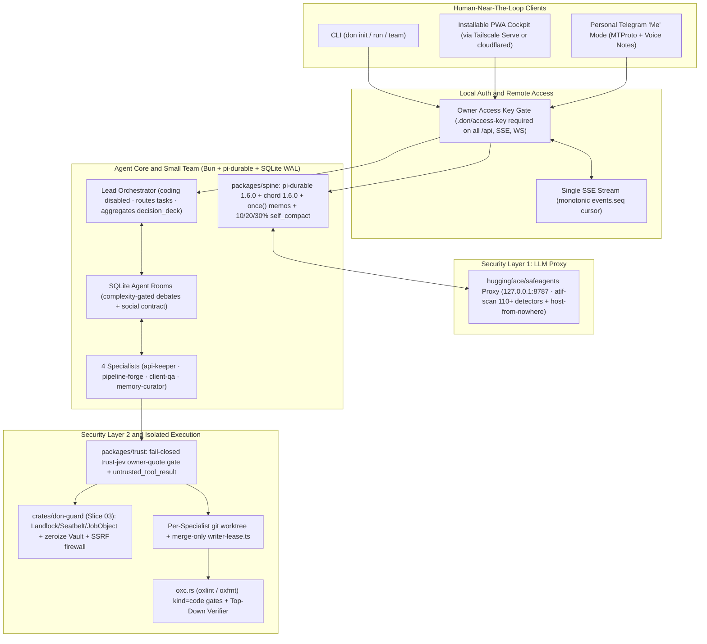

# Don-Bot Specification (`SPEC.md`)

**Project:** Don-Bot — On-the-Run Dark Factory (`github.com/aegntic/don-bot`)  
**Target OS Support:** Linux, macOS, Windows  
**Slice 01 Target Date:** December 1, 2026  

---

## 1. System Goal & Design Principles

Don-Bot is a single-box, local-first autonomous engineering factory. You hand off an engineering goal, stay near the loop for high-leverage decisions, and wake up to verified code.

1. **Zero Heavy Infrastructure:** Run everything from one SQLite WAL database (`node:sqlite` built into Bun/Node 22+) and local `git worktree` checkouts. Require zero Docker daemons, zero PostgreSQL instances, zero cloud VMs, and zero C++ native build toolchains on `install`.
2. **Hybrid Performance & Security Stack:**
   - **Agent Core & UI (`Bun 1.4+` + `TypeScript` + `oxc.rs`):** `@earendil-works/pi-durable@1.6.0` + `@earendil-works/chord@1.6.0` + `@earendil-works/pi-codemode@1.6.0` power the durable agent loop, CLI, and web server. `oxc.rs` (`oxlint` and `oxfmt`) runs sub-100ms deterministic `kind="code"` lint and format checks after agent edits.
   - **Security Boundary (`crates/don-guard` in Rust, Slice 03):** Isolate OS sandboxing, AES-256-GCM Blind Vault secrets with `zeroize` RAM wiping, `x-mcp-header` injection, and the IP-class SSRF firewall in a small standalone Rust binary so untrusted scripts cannot tamper with JavaScript process memory.
   - **Desktop Delivery:** Ship a local daemon + installable PWA (`packages/ui`) that runs identically on Linux, macOS, Windows, iOS, and Android. Add an optional Rust **Tauri** wrapper after Slice 05.
3. **Greenfield Monorepo + Selective Porting:**
   - Archive the current `n8n-io/nod` fork in `/home/ae/Projects/don-bot` to branch `legacy/nod-reference`.
   - Rebuild `main` as a clean 5-package monorepo (`packages/spine`, `packages/team`, `packages/trust`, `packages/channels`, `packages/ui`, plus `packages/cli` and Slice 03 `crates/don-guard`).
   - Keep Apache-2.0 attribution in `NOTICE` and cherry-pick only the tested security modules from `legacy/nod-reference`:
     - `src/server/trust-jev*.ts`, `trust-jev-model.json`, `trust-basis.ts`, `trust-facts.ts` (replacing the unavailable `@dna/jev` npm slug)
     - `src/runtime/untrusted.ts` and `src/shared/untrusted.ts`
     - `src/server/vault-crypto.ts` and `src/server/vault-use.ts` (encryption and secret redaction only)
     - `src/shared/public-address.ts` and `src/shared/loopback.ts`
     - `src/server/turn-cancellation.ts` (turn lock, `AbortSignal`, and turn withdrawal semantics)

---

## 2. Macro Architecture

---

## 3. Five-Slice Roadmap Matrix

| Slice | Package Focus | Core Capabilities Delivered |
| :--- | :--- | :--- |
| **Slice 01 // Spine + Basic Team** *(Target: Dec 1, 2026)* | `spine`, `team` (core), `trust` (core), `cli` | • Greenfield Bun + `oxc.rs` (`oxlint`/`oxfmt`) monorepo on `node:sqlite` WAL • `@earendil-works/pi-durable@1.6.0` + `chord@1.6.0` with monotonic `events.seq`, `once()` idempotency memos, `InterruptedToolMessage`, `withTurnLock`, and turn withdrawal • 10% / 20% / 30% `self_compact({ note_to_self })` context gauge • Auto-managed `huggingface/safeagents` local proxy sidecar (`127.0.0.1:8787`) • Basic `1 Lead + 4 Specialists` SQLite rooms with complexity-gated debates • Per-specialist `git worktree` (`.don/worktrees/<task>-<role>`) + merge-only `writer-lease.ts` • 4-tier vendor-agnostic `don.config.yaml` (1-key BYOK) + SQLite FTS5/BM25 quote-anchored memory • Zero-cost `--faux` scripted `SIGKILL` crash test (`bun run test:crash`) |
| **Slice 02 // Full Team & Verification** | `team`, `spine` | • Full 3-round cross-lane architectural negotiation rooms (triggered only on multi-lane tasks) • Un-promptable Top-Down sibling Verifier (`max_loops: 3`) watching session logs on stop • Dead-letter cooldown: park failing tasks in `blocked_needs_human` after `2` failed runs or `3` Verifier loops and pause Cron wakes • Deterministic `oxc.rs` (`oxlint`/`oxfmt`) + test runner `kind="code"` phase envelopes • Subagent privilege stripping (strip Git push keys, channel secrets, enforce depth/instance/idle caps) • Time-travel replay and fork from any saved step `N` without re-running `once()` side effects |
| **Slice 03 // Trust, Blind Vault & Rust `don-guard`** | `trust`, `crates/don-guard` | • Ported fail-closed `trust-jev.ts` owner-quote calibrated checker (~300ms) • Unified per-tool permission & approval schema (`always_allow`, `always_ask`, `always_deny` with canonical JSON payload binding) • Standalone Rust binary `crates/don-guard` behind `SandboxPort` and `VaultPort`: &nbsp;&nbsp;- Native OS sandboxing (Linux `Landlock` + `seccomp-BPF`, macOS `Seatbelt`, Windows `Job Objects`) &nbsp;&nbsp;- `zeroize` AES-256-GCM Blind Vault (API keys, OAuth, Git SSH keys, staging logins — never card PANs) + `x-mcp-header` outbound injection + stdout/screenshot masking &nbsp;&nbsp;- IP-class SSRF firewall blocking Tailscale (`100.64.0.0/10`), loopback, RFC1918, NAT64, and cloud metadata (`169.254.0.0/16`) • 3-tier budget circuit breakers (`$0.25`/5m subagent, `$2.00`/task, `$15.00`/day, auto-downshift at 70% burn) • One-tap signed rollback checkpoints (git worktree ref + SQLite savepoint) • 24-hour Shadow Mode trust calibration for newly added tools/specialists |
| **Slice 04 // Telegram "Me" Mode & Remote Access** | `channels` (`mtproto`), `spine` API | • `@mtcute/node@0.32.8` + `@mtcute/sqlite` behind `ChannelPort`: QR login, auto-created supergroup Forum Topics, auto-filed `"Factories"` folder • Two-zone outbound firewall (internal factory rooms speak freely; external chats require owner quote or `👍` draft approval in Saved Messages) • Anti-flag protections: single pinned Linux/desktop session, human read/typing delay pacing, invite links only (no forced `inviteToChannel`), `EXCLUSIONS.txt` denylist • Telegram voice notes -> STT -> Lead batch-resolving `decision_deck` items • Zero-port remote access via **Tailscale Serve** or **`cloudflared` tunnel** + `.don/access-key` owner auth + resumable monotonic `seq` SSE cursor *(Optional Slice 04b: WhatsApp Baileys adapter behind `ChannelPort`)* |
| **Slice 05 // 3-Pane Liquid PWA Cockpit** | `ui` | • Local HTTP/SSE server + installable PWA (works identically on Linux, macOS, Windows, iOS, Android) • On-demand headless Chromium + CDP `Page.startScreencast` with `handback_at` human takeover semantics (only active during browser tasks) • Lean animation stack: `motion/react` (spring physics tokens), native CSS View Transitions (`element.startViewTransition()`), `@starting-style`, `@number-flow/react`, and 6–8 `@kokonutui-pro` components (`agent-inbox`, `agent-questions`, `steer-composer`, `run-trace`, `tool-permissions`, `action-search-bar`) • 100% declarative Agentic Access Parity (agents mutate typed SQLite views, Core 4 config, themes, navbars, hotkeys — never raw React TSX) • Sandboxed preview boundary (`<iframe sandbox="allow-scripts">` without `allow-same-origin` + no-network CSP) • Cost-per-outcome receipts (`$0.42 · 4m 12s · 3/3 checks passed`) *(Post-Slice 05: optional Rust Tauri wrapper, optional `sqlite-vec` embedding provider, real-time bidirectional browser voice)* |

---

## 4. Explicit Non-Goals & Cuts Register

Do **not** re-introduce these items without a written spec change:

| Cut Item | Replacement / Why Removed |
| :--- | :--- |
| Electron desktop packaging (`~300 MB` + OS code signing) | Installable PWA (Slice 05) + optional Rust Tauri wrapper post-Slice 05 |
| PostgreSQL, `pg-boss`, Docker-for-core | Embedded SQLite WAL (`node:sqlite`) + `pi-durable` / `chord` |
| Composio SaaS middleman | Local MCP + `don-bot` deferred `tool_search` + `x-mcp-header` Blind Vault |
| Dual agent engine (Hermes subprocesses + Pi) | Standardized 100% on `@earendil-works/pi-durable` + `@earendil-works/chord` |
| Always-on `Xvfb` + `noVNC` desktop containers | On-demand headless Chromium + CDP `Page.startScreencast` |
| Consumer `pay` (stored PAN/CVV) & `@1password/sdk` Electron helper | Dev-focused Blind Vault (`crates/don-guard` / AES-256-GCM for API keys, SSH, OAuth, staging logins) |
| Custom `omnara` WebSocket relay server (`daemonprotocol`) | Tailscale Serve or `cloudflared` tunnel + monotonic `seq` SSE cursor |
| Bloated 6-layer motion stack (`GSAP`, `Rive`, `Remotion`, `Three.js`, `Matter.js`, `@formkit/auto-animate`, 5 extra UI registries, `motion_harness`) | Lean stack: `motion/react`, native CSS View Transitions / `@starting-style`, `@number-flow/react`, 6–8 `@kokonutui-pro` components |
| Arbitrary agent edits to live React `.tsx` source files | Declarative SQLite UI schema / Core 4 YAML mutations only |
| Unconditional 3-round room debates on every prompt | Complexity-gated: single-lane tasks route directly; cross-lane architecture opens rooms |
| Heavy ONNX weights in default install & WhatsApp/live voice in v1 | SQLite FTS5/BM25 provenance first; Telegram MTProto + voice notes first (`ChannelPort` allows adapters later) |

---

## 5. Non-Negotiable Safety, Model & Git Invariants

1. **Dual-Layer Fail-Closed Tool Security:**
   - Layer 1 (`safeagents` proxy) runs `10–20 ms` offline `atif-scan` + host-from-nowhere checks before any LLM tool call reaches the runtime.
   - Layer 2 (`trust-jev.ts` + `don-guard`) checks external/mutating actions against verbatim owner quotes. If J-JEV is unreachable, times out, or returns uncertain, **fail closed** to `always_ask` — never silently allow or silently fall back to the work model.
2. **Loopback Is Not Identity:**
   - Every `/api/*`, SSE, and WebSocket endpoint requires the generated owner token from `.don/access-key` (never passed into sandboxes, worktrees, or LLM prompts).
3. **XSS-Proof Center Focus Previews:**
   - Render agent-generated HTML exclusively inside `<iframe sandbox="allow-scripts">` (never `allow-same-origin`) with a strict no-network CSP header.
4. **Turn Lock & Withdrawal Discipline:**
   - Every state mutation acquires `withTurnLock`. Stopping a turn immediately fires `AbortSignal`, refuses late writes, and marks interrupted/failed owner turns `withdrawn` so aborted prompts cannot authorize future actions or enter memory.
5. **Static 3-Layer Prompt Prefix:**
   - Keep `Core System Prompt` -> `Repo Map` -> `Lane Social Contract` static across turns. Place moving timestamps, counters, and live room feeds strictly *below* the prompt-cache breakpoint.
6. **Vendor-Agnostic 4-Tier Models & Editable Budget Caps:**
   - Configure four logical roles in `don.config.yaml`: `architect`, `workhorse`, `fast`, and `gate` (zero hardcoded vendor lock-in).
   - Default spend circuit breakers: `$0.25` / `5m` per subagent, `$2.00` per task (auto-downshift at 70%), `$15.00` per day — user-editable in `don.config.yaml`.
7. **Git Worktree Hygiene & Push Guard:**
   - Specialists code inside `.don/worktrees/<task>-<role>` sharing the global package store; auto-GC worktrees after merge/archive.
   - Only Lead/Verifier merges to `main` may acquire `writer-lease.ts`. Specialists must **never** `git push`, force-push, or open pull requests without an explicit approved `always_ask` card plus a secret scan.

---

## 6. Five Mandatory CI Chaos Smoke Tests

Every slice release must pass these five automated deterministic checks (zero live paid model calls in CI):

| Test | Scenario Tested | Pass Requirement |
| :--- | :--- | :--- |
| **1. `SIGKILL` Replay** | Kill process mid-tool during `--faux` scripted run | Process restarts from SQLite WAL; `once()` side effect executes **once total**; interrupted non-idempotent step receives `InterruptedToolMessage` |
| **2. Forced Compaction** | Drive context usage to `30%` hard threshold | Tools block except `self_compact`; agent writes `note_to_self` and retains active task state after compaction boundary |
| **3. Prompt-Injection Defense** | Inject malicious curl/env exfil instructions inside untrusted file/tool output | `untrusted_tool_result` isolates payload; `safeagents` + J-JEV + SSRF block outbound call and secret read |
| **4. Worktree Merge Conflict** | Two specialists modify overlapping files in parallel `.don/worktrees/*` | Parallel edits do not corrupt checkouts; `writer-lease.ts` serializes merge into `main`, detects conflict, and resolves cleanly via gate/verifier |
| **5. Budget Circuit Breaker** | Simulated token/subagent burn crosses task `$2.00` or subagent `$0.25` cap | Execution halts immediately without overrun and queues one `decision_deck` card requesting approval to continue |
