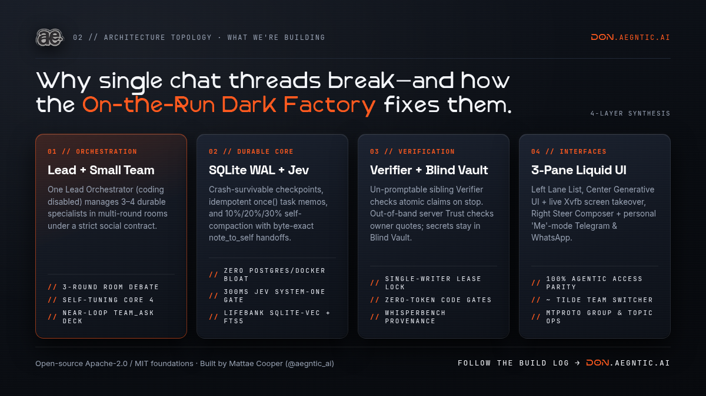
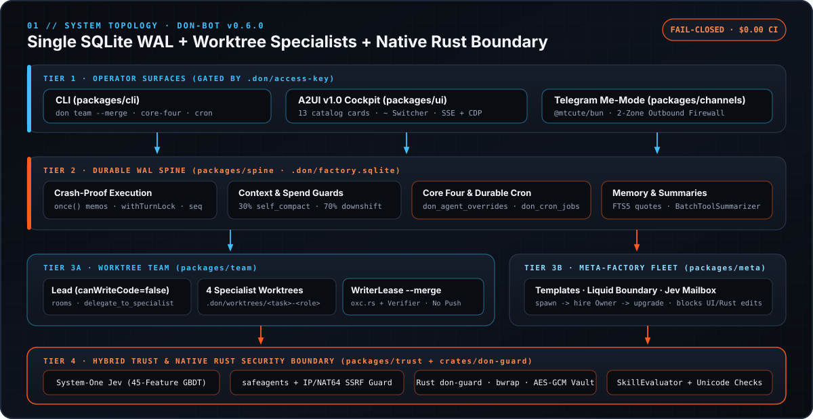
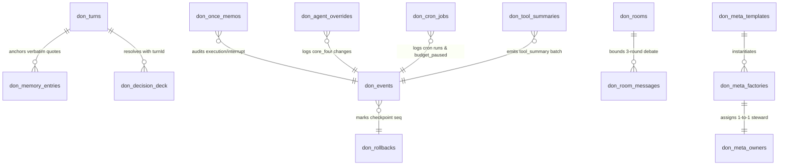
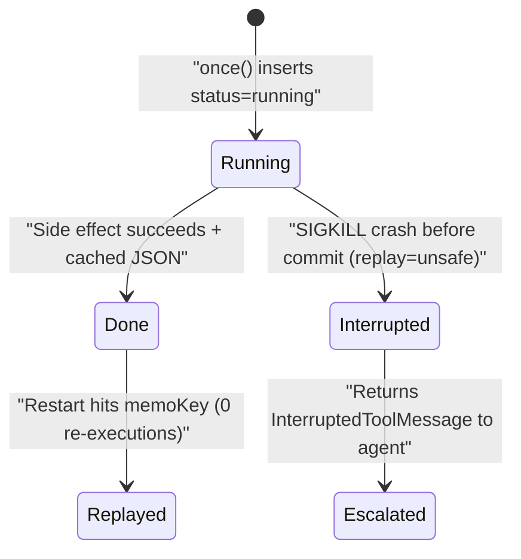
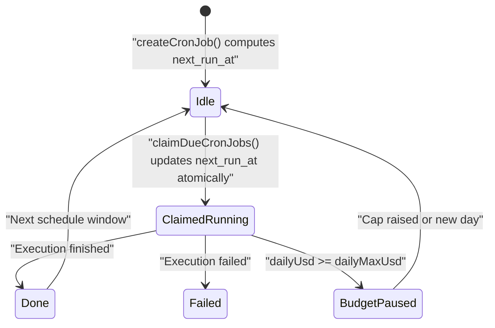
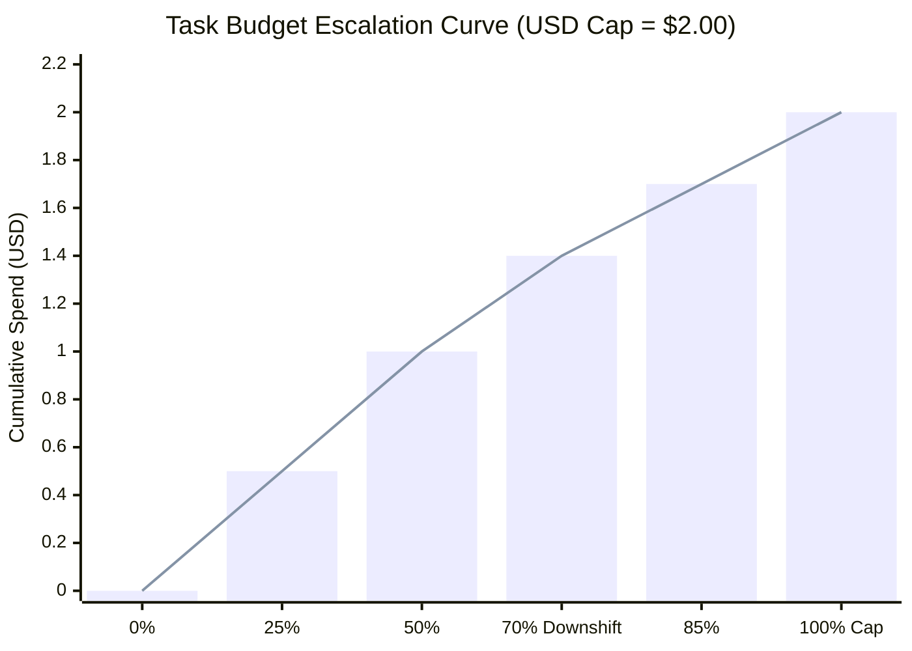
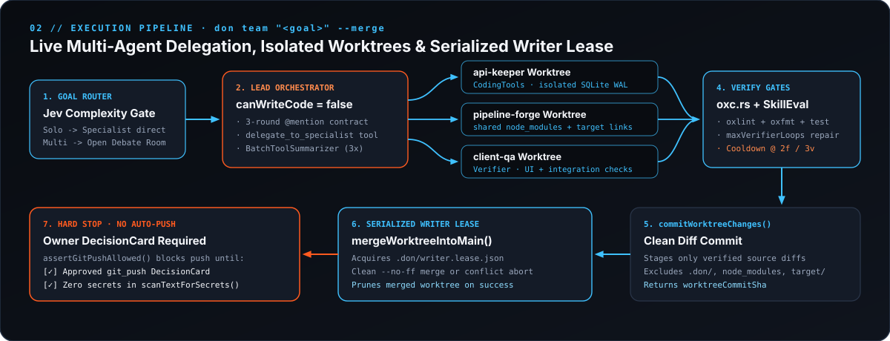
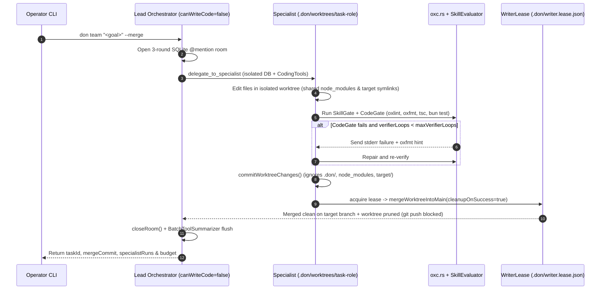
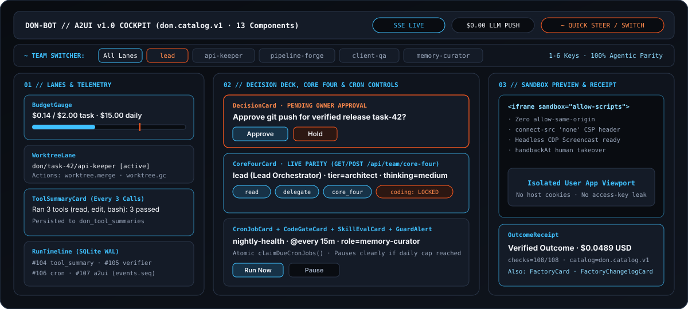

# Don-Bot Architecture Deep Dive

  

Don-Bot is structured as a 6-package TypeScript/Bun monorepo (`packages/*` plus `packages/cli`) paired with a standalone native Rust security binary (`crates/don-guard` `v0.6.0`), backed by a single SQLite WAL database (`.don/factory.sqlite`) and isolated per-specialist `git worktree` checkouts.

> See [`WORKFLOWS.md`](./WORKFLOWS.md) for visual end-to-end onboarding, delegation, Core Four, Cron, and Meta-Factory flowmaps.

---

## 1. Durable Execution Spine (`packages/spine`)

Don-Bot wraps `@earendil-works/pi-durable`, `@earendil-works/chord`, and Bun's native `node:sqlite` (`DatabaseSync`) in WAL mode:

- **Idempotent Side Effects (`once()` — [`events.ts`](../packages/spine/src/events.ts)):** Before invoking an external side effect, `once(db, { memoKey, runId, replay }, fn)` atomically inspects `don_once_memos` inside a SQLite transaction. Completed keys replay cached outputs; interrupted `unsafe` runs emit `InterruptedToolMessage` so restarts never duplicate side effects.
- **Turn Lock & Cancellation ([`turn-lock.ts`](../packages/spine/src/turn-lock.ts)):** `withTurnLock` and `withdrawTurn` ensure late or aborted owner turns fail closed across memory writes, outbound messages, and `DecisionCard` execution.
- **Compaction & Spend Circuit Breakers ([`compact.ts`](../packages/spine/src/compact.ts) · [`budget.ts`](../packages/spine/src/budget.ts)):** Enforces `10% / 20% / 30%` forced `self_compact` handoffs alongside `$0.25` subagent, `$2.00` task (`70%` fast-tier downshift), and `$15.00` daily spend caps.
- **Time-Travel Checkpoints & Signed Rollbacks ([`replay.ts`](../packages/spine/src/replay.ts) · [`rollback.ts`](../packages/spine/src/rollback.ts)):** Captures step snapshots (`forkRunFromStep`) and HMAC-SHA256 signed git refs (`refs/don/rollbacks/rb-*`) anchored to `don_events.seq`.
- **Core Four Overrides ([`core-four.ts`](../packages/spine/src/core-four.ts)):** Persists per-role `modelTier`, `provider`, `modelId`, `thinkingLevel`, `enabledSlices`, and `extraInstructions` in `don_agent_overrides` while enforcing fail-closed `NON_CODING_ROLE_IDS` (`lead`, `memory-curator`).
- **Durable Cron Scheduler ([`cron.ts`](../packages/spine/src/cron.ts)):** Stores scheduled prompts in `don_cron_jobs` (`@every`, `@hourly`, `@daily`, and 5-field schedules) and uses transactional `claimDueCronJobs()` to prevent double firing across restarts.
- **Batch Tool Summarizer ([`tool-summarizer.ts`](../packages/spine/src/tool-summarizer.ts)):** Buffers tool calls (`ToolTask.afterTool`) and flushes secret-scrubbed <=2-line plain-English summaries every `3` calls into `don_tool_summaries` and `'tool_summary'` WAL events.

### 1.1 SQLite WAL Schema Relationships

### 1.2 Crash Replay & Durable Cron Lifecycles

### 1.3 Budget Circuit Breakers & Context Compaction Thresholds

| Guard Mechanism | Thresholds | Action Taken |
| :--- | :--- | :--- |
| **Context Window Compaction** | `10%` notice · `20%` warning · `30%` lock | Blocks non-compact tools until `self_compact({ note_to_self })` |
| **Subagent Circuit Breaker** | `$0.25` USD / `5 min` | Aborts runaway child run cleanly |
| **Task Spend Breaker** | `70%` (`$1.40`) downshift · `100%` (`$2.00`) halt | Switches tier to `fast`, then opens idempotent `budget_limit` `DecisionCard` |
| **Daily Spend Breaker** | `$15.00` USD | Blocks live tool execution and pauses background Cron jobs (`budget_paused`) |

---

## 2. Hybrid Trust Boundary (`packages/trust` & `crates/don-guard`)

Don-Bot isolates security-critical primitives outside agent and JS control flow:

| Component | Source | Responsibilities |
| :--- | :--- | :--- |
| **Rust Security Worker (`v0.6.0`)** | [`crates/don-guard/src/main.rs`](../crates/don-guard/src/main.rs) | Cross-platform JSON IPC worker: `health`, `ssrf-check` (RFC1918, `100.64.0.0/10`, `169.254.0.0/16`, NAT64), `Zeroizing` AES-256-GCM Blind Vault (`vault.rs`, rejects Luhn PANs), `env_clear()` + Linux `bwrap` execution + `[REDACTED:VAULT]` masking (`sandbox.rs`) |
| **System-One Jev + GBDT** | [`jev-client.ts`](../packages/trust/src/jev-client.ts) · [`trust-jev.ts`](../packages/trust/src/trust-jev.ts) | Combines decision models (`typesafe/jev-1.14`, OpenRouter, or deterministic faux) with the 45-feature GBDT ensemble across 5 gates (`ToolTask`, Complexity Router, Verifier Stop, Memory Promotion, Outbound Firewall) |
| **NVIDIA SkillEvaluator** | [`skill-evaluator.ts`](../packages/trust/src/skill-evaluator.ts) | Scans `SKILL.md` for YAML schema, PII, secrets, Unicode tag smuggling (`U+E0000`), and 6-harness compatibility before install or template backport |

---

## 3. Worktree Team, Delegation & Writer Lease (`packages/team`)

---

## 4. A2UI `v1.0` Cockpit, `~` Switcher & Telegram (`packages/ui` · `packages/channels`)

- **Strict 13-Component Catalog ([`a2ui.ts`](../packages/ui/src/a2ui.ts)):** Rejects all raw HTML/JS/CSS markup and enforces `don.catalog.v1` across `DecisionCard`, `BudgetGauge`, `CodeGateCard`, `SkillEvalCard`, `WorktreeLane`, `GuardAlert`, `RunTimeline`, `OutcomeReceipt`, `FactoryCard`, `FactoryChangelogCard`, `CoreFourCard`, `CronJobCard`, and `ToolSummaryCard`.
- **`~` Tilde Team Switcher & Live Parity ([`pwa-html.ts`](../packages/ui/src/pwa-html.ts) · [`server.ts`](../packages/ui/src/server.ts)):** Lets operators switch live across lanes (`lead`, `api-keeper`, `pipeline-forge`, `client-qa`, `memory-curator`), toggle Core Four slices via `POST /api/team/core-four`, trigger or pause Cron jobs via `/api/cron*`, and review `BatchToolSummarizer` entries at `$0.00` LLM token cost over SSE (`events.seq`).
- **CDP Screencast & Telegram "Me" Mode ([`cdp-stream.ts`](../packages/ui/src/cdp-stream.ts) · [`telegram.ts`](../packages/channels/src/telegram.ts)):** On-demand Chromium verification with `handbackAt` takeover and cold-start retry hardening, paired with pure-Bun `@mtcute/bun` Telegram rooms behind `EXCLUSIONS.txt` and two-zone outbound gates.

---

## 5. Level 4 Meta-Factory Fleet (`packages/meta`)

- **Blank Factory Templates & Skill Backports ([`templates.ts`](../packages/meta/src/templates.ts)):** Clones `don-core-v1`, gates backports through NVIDIA SkillEvaluator + single-use `DecisionCard`s.
- **Liquid Boundary ([`roles.ts`](../packages/meta/src/roles.ts)):** Permits declarative edits (`config.yaml`, `roster.yaml`, `SKILL.md`, workflows, macros) while hard-blocking UI source (`packages/ui`, `.tsx`/`.html`) and Rust security files (`crates/don-guard`, `vault.ts`, `ssrf.ts`).
- **1:1 Fleet Stewards & Jev Mailbox ([`registry.ts`](../packages/meta/src/registry.ts) · [`mailbox.ts`](../packages/meta/src/mailbox.ts)):** Upgrades isolated child factories idempotently via `once()` and secures inter-factory messaging with `.don/access-key`, `<untrusted_tool_result>` escaping, SSRF checks, and Jev gates.
