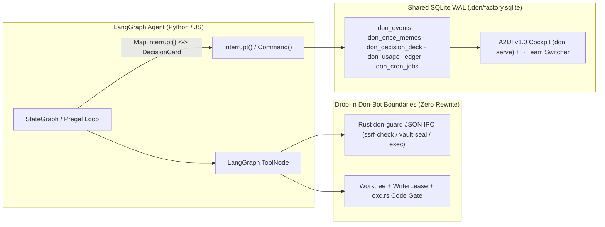

# Don-Bot ↔ LangGraph Portability & Bridge Guide

> **Applies to:** Don-Bot `v0.6.0` · **Target Counterparts:** LangGraph (`Python` & `JavaScript/TypeScript`)

Most of Don-Bot's safety, durability, and operator-cockpit guarantees live **outside the LLM harness** (as a standalone Rust JSON-IPC worker, SQLite WAL tables, isolated `git worktree` checkouts, and an A2UI `v1.0` SSE server), while LangGraph excels inside **graph-level state orchestration**. That architectural split makes the two systems highly complementary and cleanly portable in both directions.

---

## Hybrid Integration Topology



---

## 1. Don-Bot → LangGraph (Highest-Value Ports)

### 1.1 Drop-In via IPC, SQLite, or CLI (Zero Rewrite)

1. **Native Rust `don-guard` Security Boundary**  
   - **Source:** [`crates/don-guard/src/main.rs`](../crates/don-guard/src/main.rs) · [`sandbox.rs`](../crates/don-guard/src/sandbox.rs) · [`ssrf.rs`](../crates/don-guard/src/ssrf.rs) · [`vault.rs`](../crates/don-guard/src/vault.rs)
   - **How it ports:** `don-guard` reads a single JSON object from `stdin` and writes a JSON response to `stdout` (`op`: `"health"`, `"ssrf-check"`, `"vault-seal"`, `"vault-open"`, `"exec"`). A LangGraph `ToolNode` (Python `subprocess.run` or JS `child_process`) can wrap shell execution and outbound fetches directly to gain `env_clear()` / `bwrap` isolation, `[REDACTED:VAULT]` stdout masking, Luhn PAN refusal, and Tailscale/NAT64/metadata/RFC1918 SSRF blocking.

   **Example Python `ToolNode` bridge:**
   ```python
   import json, subprocess
   from pathlib import Path

   DON_GUARD = str(Path.home() / ".don" / "bin" / "don-guard")

   def guarded_call(payload: dict) -> dict:
       proc = subprocess.run(
           [DON_GUARD],
           input=json.dumps(payload),
           text=True,
           capture_output=True,
           check=False,
       )
       res = json.loads(proc.stdout or "{}")
       if not res.get("ok"):
           raise RuntimeError(res.get("error", "Blocked by don-guard"))
       return res

   # 1. Fail-closed SSRF check before HTTP fetch
   guarded_call({"op": "ssrf-check", "url": "https://api.example.com/v1/health"})

   # 2. Scrubbed execution with injected + masked secrets
   out = guarded_call({
       "op": "exec",
       "command": "pytest",
       "args": ["-q"],
       "cwd": "/path/to/worktree",
       "timeoutMs": 60000,
       "injectEnv": {"API_TOKEN": raw_secret},
       "maskSecrets": [raw_secret],
   })
   ```

2. **A2UI `v1.0` Cockpit & Zero-LLM SSE Telemetry**  
   - **Source:** [`packages/ui/src/a2ui.ts`](../packages/ui/src/a2ui.ts) · [`macros.ts`](../packages/ui/src/macros.ts) · [`server.ts`](../packages/ui/src/server.ts)
   - **How it ports:** The Cockpit hydrates from `.don/factory.sqlite` (`don_events`, `don_decision_deck`, `don_usage_ledger`, `don_tool_summaries`, `don_cron_jobs`, `don_agent_overrides`). Any LangGraph app that mirrors node transitions, cost rows, and interrupts into those SQLite tables gets Don-Bot's 3-pane Cockpit, `~` Team Switcher, and `$0.00`-LLM SSE patch stream via `don serve`.

3. **Git Worktree Isolation + `WriterLease` + `oxc.rs` Code Gate**  
   - **Source:** [`packages/team/src/worktree.ts`](../packages/team/src/worktree.ts) · [`code-gate.ts`](../packages/team/src/code-gate.ts)
   - **How it ports:** Wrap LangGraph coding nodes so edits happen inside `.don/worktrees/<thread_id>-<role>`, verify via `runCodeGate` (`oxlint`/`oxfmt`/tests), commit modified files excluding `.don/` and `node_modules/`, merge serially under `WriterLease`, and gate `git push` on explicit owner approval + secret scan.

---

### 1.2 Pattern Ports (Direct Equivalence in LangGraph Nodes & Middleware)

| Don-Bot Capability | Don-Bot Source | LangGraph Counterpart / Port Pattern |
| :--- | :--- | :--- |
| **System-One Jev Gate + Untrusted Delimiters** | [`packages/trust/src/jev-client.ts`](../packages/trust/src/jev-client.ts) · [`runtime.ts`](../packages/spine/src/runtime.ts) | Pre-`ToolNode` conditional edge / middleware wrapping external outputs in untrusted delimiters, scoring mutations via the 45-feature GBDT + Jev classifier, and routing `always_ask` into `interrupt()`. |
| **Idempotent `once()` Side-Effect Memos** | [`packages/spine/src/events.ts`](../packages/spine/src/events.ts) | Wrap external mutations inside a `don_once_memos` SQLite guard (`running` -> `done` \| `interrupted` + `InterruptedToolMessage`) so crashes *inside* a node never duplicate side effects on replay (complementing `SqliteSaver` / `@task`). |
| **Spend Breakers & 70% Tier Downshift** | [`packages/spine/src/budget.ts`](../packages/spine/src/budget.ts) | LangGraph callback tracker + dynamic model router enforcing subagent, task (`70%` downshift to `fast` tier), and daily hard caps. |
| **Core Four Parity & Non-Coding Lead Invariant** | [`packages/spine/src/core-four.ts`](../packages/spine/src/core-four.ts) | Map `don_agent_overrides` into `RunnableConfig["configurable"]` (model, thinking level, harness slices) and reject coding tools on orchestrator/curator nodes. |
| **Batch Tool Summarizer** | [`packages/spine/src/tool-summarizer.ts`](../packages/spine/src/tool-summarizer.ts) | Post-tool hook buffering every 3 tool calls into a secret-scrubbed <=2-line summary stored out-of-band without bloating graph message state. |
| **Durable Cron & FTS5 Quote Memory** | [`packages/spine/src/cron.ts`](../packages/spine/src/cron.ts) · [`db.ts`](../packages/spine/src/db.ts) | Back LangGraph scheduled triggers with `claimDueCronJobs()` (preventing double-firing) and enforce verbatim `owner_quote` anchors on `don_memory_fts` writes. |

---

## 2. LangGraph → Don-Bot (Recommended Upstream Enhancements)

1. **Typed Graph Reducers & Explicit State Channels (`Annotated[list, reducer]`):** Replace prompt-only multi-agent routing in [`packages/team/src/orchestrator.ts`](../packages/team/src/orchestrator.ts) with typed DAG state reducers for deterministic fan-out/fan-in across specialists.
2. **Dynamic Map-Reduce (`Send` API):** Dynamically fan out $N$ parallel specialist worktrees from a planning step and reduce verified envelopes into Lead under `WriterLease`.
3. **Atomic `Command(goto, update)` & First-Class `interrupt()` / `resume`:** Unify tool output + next-lane routing in a single transition aligned with `don_decision_deck` and `don resume`.
4. **Interactive Time-Travel State Editing:** Extend [`don_step_snapshots`](../packages/spine/src/replay.ts) (`forkRunFromStep`) with LangGraph-style `update_state` before replaying forward from the A2UI Cockpit.
5. **Hierarchical Cross-Thread `Store` + Hybrid Vector Search:** Pair LangGraph-style `(org, repo, role)` namespaces with Don-Bot's FTS5 BM25 quote-anchored memory for hybrid lexical + semantic recall.
6. **OpenTelemetry Trace Export:** Emit standard OTel spans alongside `don_events` for external trace observability.

---

## 3. Non-Portable / Decoupled Internals

| Boundary | Don-Bot Implementation | LangGraph Implementation | Guidance |
| :--- | :--- | :--- | :--- |
| **Execution Engine** | `@earendil-works/pi-durable` (`Harness`, `GenerationTask`, `ToolTask`) | Pregel superstep runtime (`StateGraph`, `Checkpointer`) | Do not couple internals; integrate strictly across CLI, Rust JSON IPC, and SQLite tables. |
| **Context Compaction** | `self_compact` tool triggered at `10%/20%/30%` context inside `pi-durable` | Graph-level `RemoveMessage` / summarizer nodes | Port the `30%` threshold policy, not the harness hook. |
| **Messaging Sidecar** | `@mtcute/bun` Telegram Me-Mode ([`packages/channels`](../packages/channels/src/firewall.ts)) | Custom channel webhooks / bots | Keep Telegram MTProto running as a standalone channel process. |
