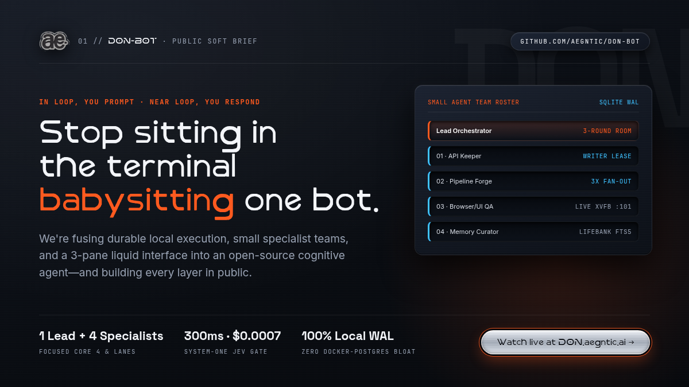
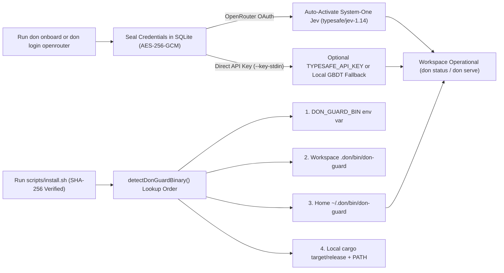
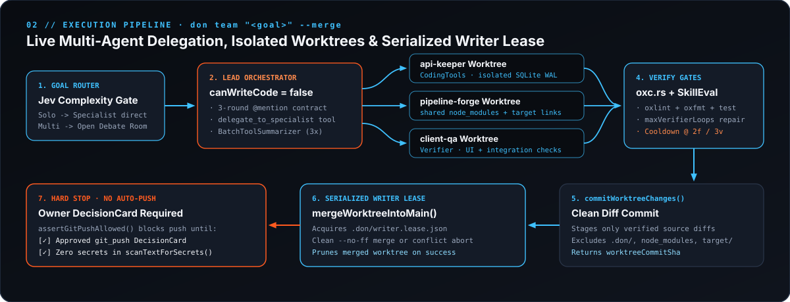
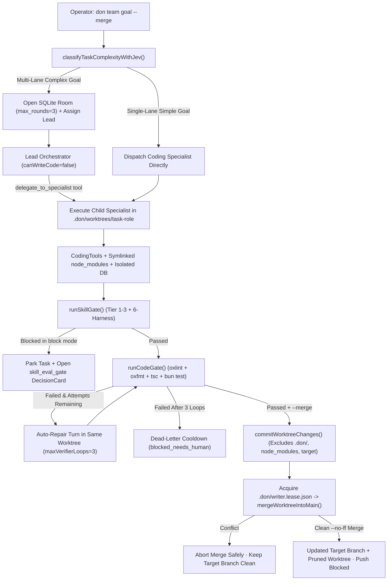
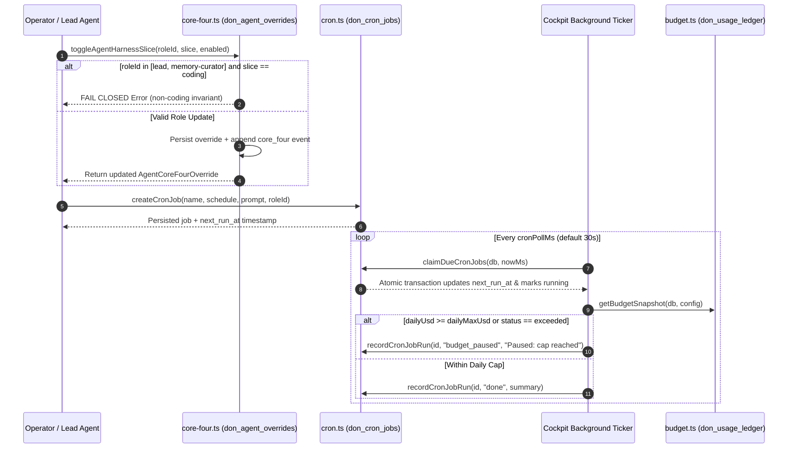
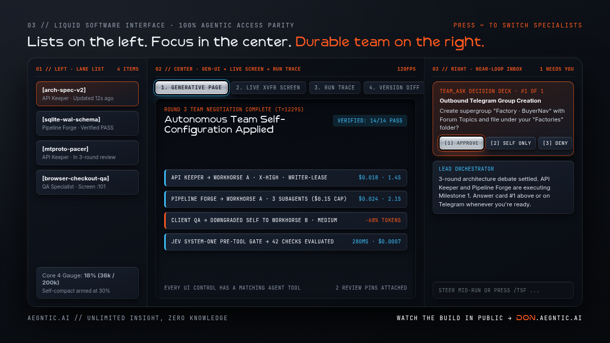
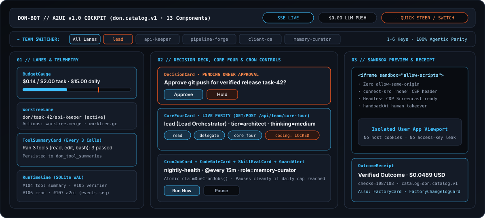
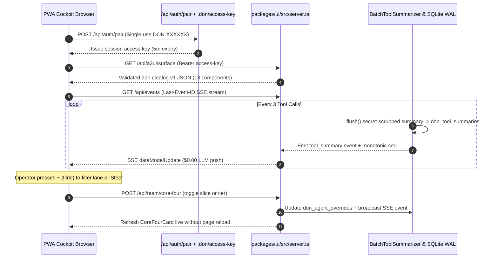
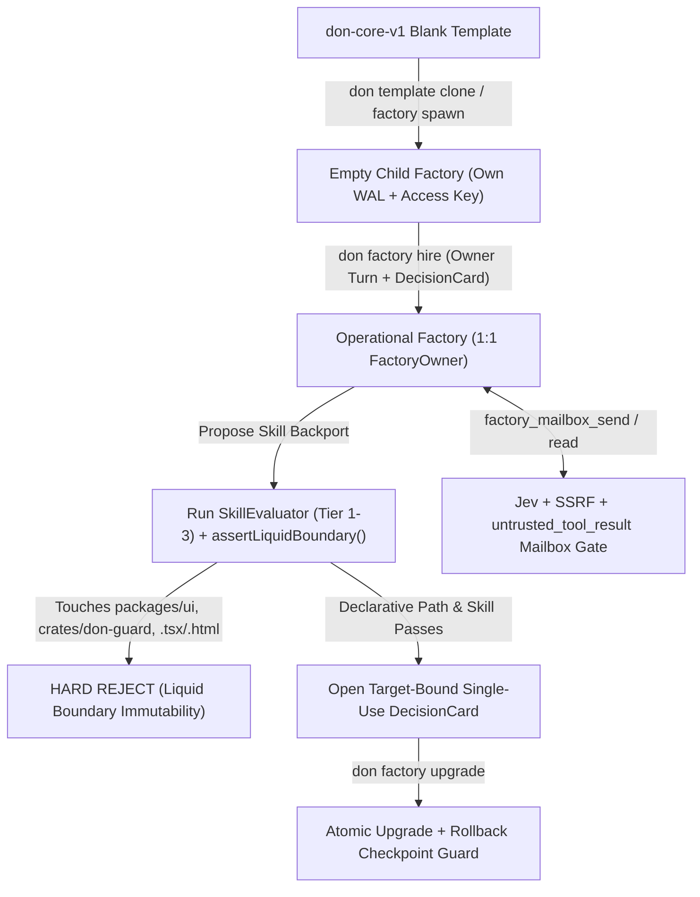

# Don-Bot Visual Workflows & Operational Playbook

  

End-to-end visual flowmaps showing how operators onboard, delegate multi-agent worktree tasks, tune per-role Core Four overrides, run durable cron jobs, operate the `~` Team Switcher cockpit, and govern Meta-Factory fleets in **`v0.6.0`**.

---

## 1. Zero-Friction Onboarding & `don-guard` Binary Discovery

---

## 2. Solo vs. Multi-Agent Worktree Delegation & `--merge` Flowmap

---

## 3. Core Four Agentic Parity & Durable Cron Loop

---

## 4. A2UI `v1.0` Cockpit, `~` Team Switcher & Zero-LLM Telemetry

  

---

## 5. Meta-Factory Fleet Governance & Cross-Factory Mailbox

